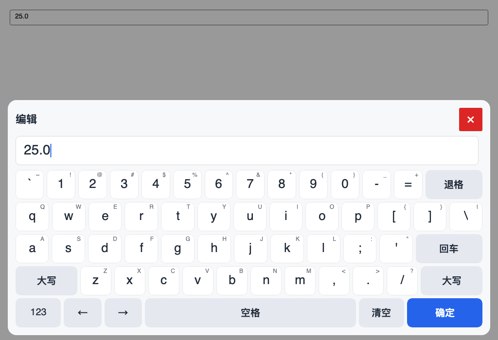
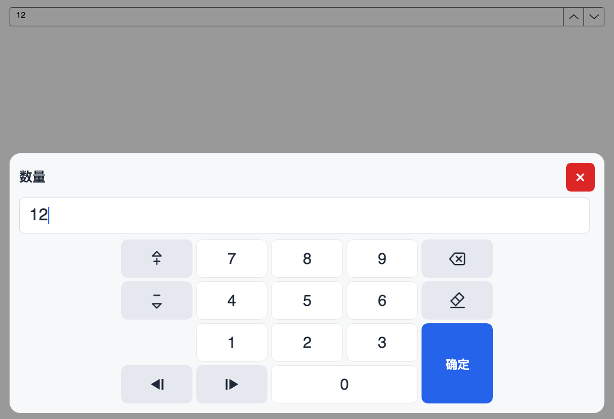
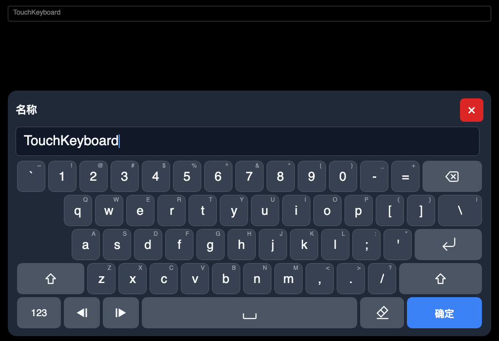

# TouchKeyboard

**English** · [简体中文](README.zh.md)

A touch-first, embedded software keyboard for small industrial touch screens.
The input logic is a pure .NET Standard 2.0 backend; Avalonia is the first
frontend, and WPF is planned.

> **Status: layout redesign and visual refinements implemented (2026-11-07).**
> The core has the ten input profiles, the strict ANSI and phone-hybrid full
> keyboards, the 5×4 Numpad cell grid, immutable layouts, session and validation;
> Avalonia has the overlay host, controller, custom editor surface, vector key
> glyphs, automatic light/dark theming, touch press feedback, built-in adapters,
> theme and zh-CN/en-US localizer. P5 publication and the rest of the hardening
> pass remain. Do not use this package in production yet.

## Why

- Small screens (8–10 inch) and industrial panels need large keys and a layout
  that does not depend on the operating system's on-screen keyboard.
- Text, integer, decimal, date and IP fields should expose only the keys they
  actually accept; a positive integer field should not show a sign or decimal
  point.
- The input rules must be testable without a UI so a second frontend can reuse
  them.

## Planned shape

| Package | Target | Purpose |
|---|---|---|
| `TouchKeyboard.Core` | `netstandard2.0` | Modes, profiles, layouts, session, validation |
| `TouchKeyboard.Avalonia` | `net8.0;net10.0` | Avalonia host, keys, adapters, theme |
| `TouchKeyboard.Wpf` | future | WPF frontend, same core |

Two keyboard modes:

1. **Full keyboard** — the strict 15-unit `AnsiStyle` ANSI geometry by default
   (five rows, commandless Tab/Caps/IME spacer cells); the four-row
   `PhoneHybrid` letters keyboard with its own symbol page is a retained
   alternative. No F keys, numpad or system keys.
2. **Numeric keypad** — a 5×4 `Numpad` shared by the general surface and the
   profile-restricted ones. Empty slots merge into their neighbour (`0` widens
   over an empty decimal slot, Confirm stretches over an empty right-row2 slot)
   instead of rendering dead keys.

Closing the panel discards edits; only **Confirm**/Enter commits. The field
label and unit are shown above the keys.







*Headless Skia renders from the 1024×700 harness. The overlay follows the window's
theme variant, so a dark shell gets the dark preset automatically; see
[docs/layouts.md](docs/layouts.md) for every geometry, the symbol page, the Numpad
slot table and the theme metrics.*

## What works now

- `InputProfile`: text, password, ASCII token, signed/positive integer,
  signed/positive decimal, date with `/` or `.`, and IPv4.
- Immutable `KeyboardLayout` data: the strict `AnsiStyle` and four-row
  `PhoneHybrid` full keyboards, the PhoneHybrid symbol page, the 5×4 `Numpad`
  as a real cell grid with spans, profile-restricted numeric keypads that omit
  sign, decimal point, separator or ABC when they are not valid, and the
  retained `Sequence` page.
- `KeyGlyph` semantic icons: backspace, clear, enter, shift (outline/filled),
  caret-bar arrows, step arrows with `+`/`−` signs, space and password
  visibility are typed icons that each frontend draws as a vector, with the
  localized label kept as the accessible name.
- `NumpadSlots` scenario mapping: step keys vs `+`/`−` characters, `ABC` vs `±`
  in the left row-2 slot, and the bottom decimal/date/IP separator.
- `KeyboardSession`: insert, backspace, clear, caret movement, per-digit
  step-up/down, sign toggle, sticky shift, mode switch, full-keyboard page
  switch, commit/cancel, max length and numeric range checks.
- Avalonia: `TouchKeyboardHost` overlay with scrim, title/unit/error row and a
  fixed five-row key area, auto-attaching controller, custom-drawn
  `TouchKeyboardEditor`, pointer-captured `TouchKey` with long-press repeat and
  vector icons, `KeyboardLayoutView`, `IEditorSurface` injection, adapters for
  `TextBox`, `NumericUpDown` and `CalendarDatePicker`, a custom adapter
  registry, light/dark themes that follow the window variant, zh-CN/en-US
  localizer and touch-first chrome with no hover states.
- 101 core tests + 23 Avalonia headless tests per target (248 executions).

Not implemented yet: WPF, NuGet publication (P5), Chinese input, and the
remaining hardening pass (real-device DPI/OSK verification, accessibility,
packaging polish).

## Repository layout

```text
src/TouchKeyboard.Core/        pure backend
src/TouchKeyboard.Avalonia/    Avalonia frontend
samples/TouchKeyboard.Demo/    demo application
tests/TouchKeyboard.Core.Tests/
tests/TouchKeyboard.Avalonia.Tests/
assets/icon.png                package icon
docs/architecture.md           layering, model and data flow
docs/avalonia.md               integration, options, theming, adapters
docs/profiles.md               input profiles, validation and numeric slots
docs/layouts.md                layout reference
docs/roadmap.md                milestones and version plan
docs/release.md                NuGet release runbook
docs/wpf-porting.md            WPF frontend notes
docs/design/decisions.md       accepted decisions
docs/adr/                      architecture decision records
docs/testing/device-checklist.md
docs/images/                   rendered previews
build/                         preflight and smoke scripts
```

## Build

Requires the .NET 8 and .NET 10 SDKs.

```bash
dotnet restore TouchKeyboard.sln
dotnet build TouchKeyboard.sln -c Release
dotnet test tests/TouchKeyboard.Core.Tests/TouchKeyboard.Core.Tests.csproj -c Release
dotnet test tests/TouchKeyboard.Avalonia.Tests/TouchKeyboard.Avalonia.Tests.csproj -c Release
dotnet pack src/TouchKeyboard.Core/TouchKeyboard.Core.csproj -c Release -o artifacts
dotnet pack src/TouchKeyboard.Avalonia/TouchKeyboard.Avalonia.csproj -c Release -o artifacts
```

Run the demo:

```bash
dotnet run --project samples/TouchKeyboard.Demo
```

The demo has selectors for the full-keyboard geometry (AnsiStyle / PhoneHybrid)
and the app theme variant (system / light / dark), so both presets and both
geometries can be inspected side by side.

Restore uses the standard NuGet package cache. In sandboxed environments, set
`NUGET_PACKAGES` to a writable directory before restoring.

## Documentation

- [Architecture](docs/architecture.md) — projects, core model, data flow, extension seams.
- [Avalonia integration](docs/avalonia.md) — setup, options, theming, adapters, troubleshooting.
- [Input profiles](docs/profiles.md) — built-in profiles, validation rules, numeric slots.
- [Layouts](docs/layouts.md) — ANSI/PhoneHybrid geometry, symbol page, Numpad grid.
- [Roadmap](docs/roadmap.md) — current status, hardening checklist, version plan.
- [Release](docs/release.md) — versioning, Trusted Publishing, release runbook.
- [WPF porting notes](docs/wpf-porting.md) — what a second frontend needs.
- [Decision records](docs/adr/) and [accepted decisions](docs/design/decisions.md).
- [Chinese input and language packs (plan, undecided)](docs/design/2026-11-08-chinese-input-and-language-packs.md) — routes, size impact and per-language NuGet package analysis.
- [Device checklist](docs/testing/device-checklist.md) — real-device acceptance for P4.

The detailed design plan for the current layout is kept locally until the public
documentation is final; decisions and geometry are summarized in the links above.

## License

MIT. See [LICENSE](LICENSE).
