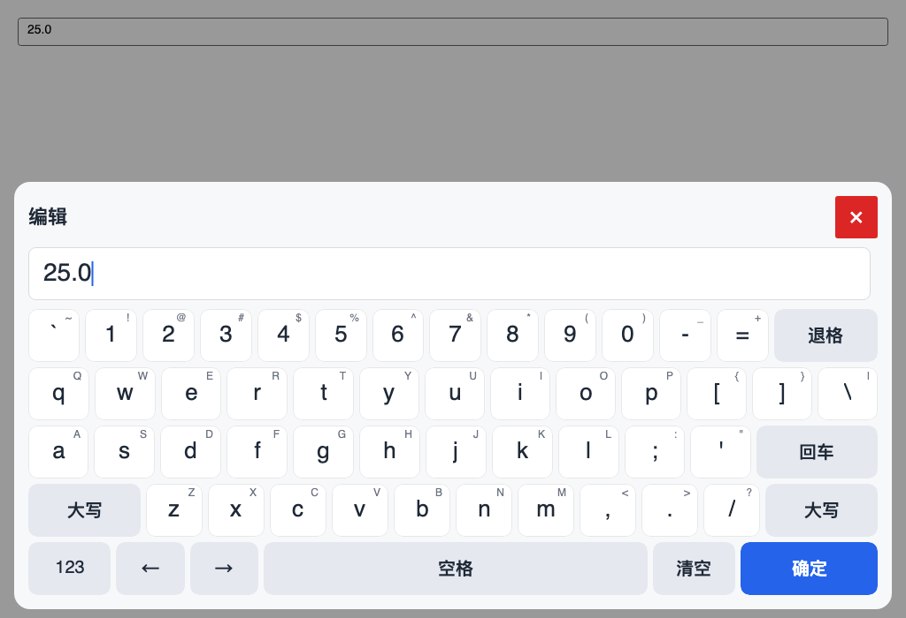
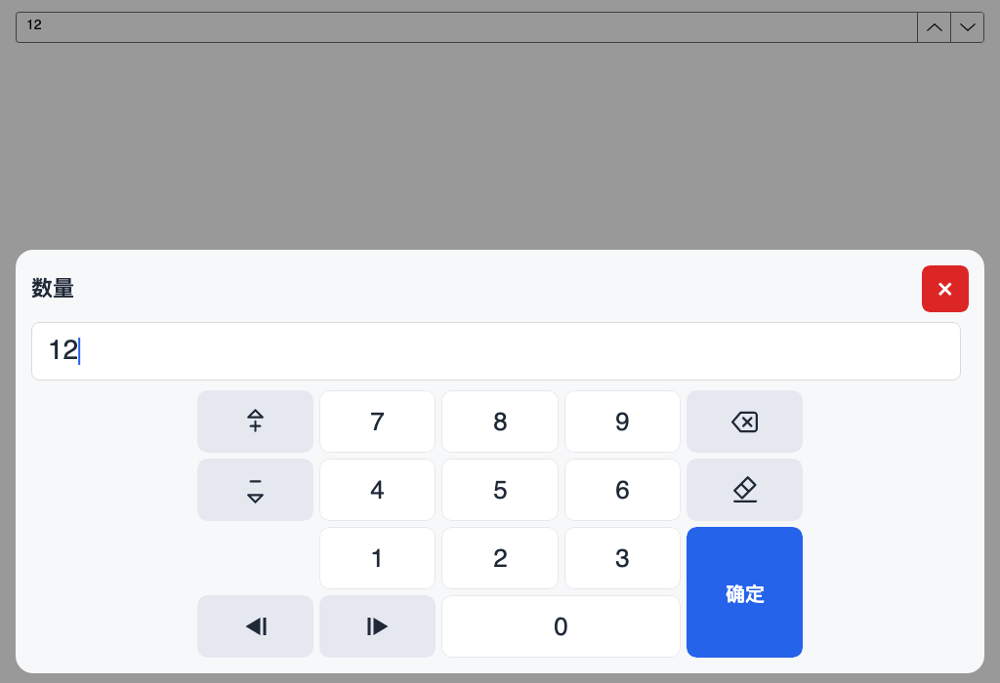
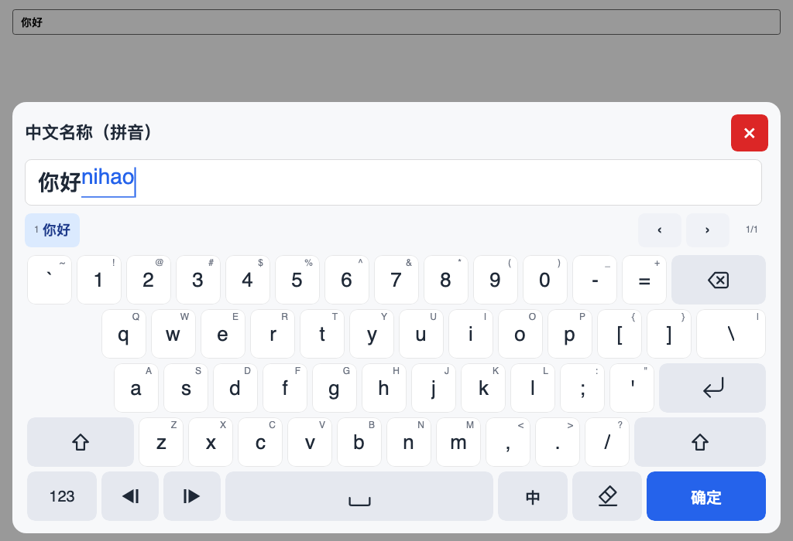

# TouchKeyboard

[English](README.md) · **简体中文**

面向小尺寸工控触摸屏的触屏软键盘。输入模型是纯 .NET Standard 2.0 核心，
Avalonia 12 是首个前端，WPF 前端在计划中。

[](https://www.nuget.org/packages/TouchKeyboard.Avalonia)
[](LICENSE)



## 特性

- **按字段生成键盘。** 十个输入档位决定字段能看到哪些键、分隔符、范围校验和
  提交规则。正整数不出现正负号和小数点，日期字段使用对应的分隔符。
- **两套全键盘形态。** `AnsiStyle` 是默认的严格 5 行、每行 15 单位 ANSI 布局；
  `PhoneHybrid` 是 4 行手机式布局，自带符号页。
- **数字小键盘。** 5×4 `Numpad` 在通用场景和档位专用场景间共用一套网格；空槽
  由相邻键合并（`0` 变宽、确定键变高），不生成禁用键。
- **窗口内浮层。** Avalonia 宿主提供遮罩、字段名/单位/错误行、编辑面和模式切换
  时高度稳定的键盘区。
- **触屏交互。** 无悬停态；支持指针捕获、整键按压反馈，以及退格和方向键的长按
  重复。
- **主题、字体与尺寸。** 自动跟随明暗主题，内置两套预设，`Style` 提供整体/字号/
  图标缩放、语义色和字体族，标题行可长按拖动；三大平台有各自的默认字体回退链，
  宿主也可以直接替换 `FontFamily`。
- **中英文按键文案。** `KeyboardLanguage.English` 为全英文项目提供整套英文键面
  （Confirm、Clear、Symbols、CN/EN）；`Auto` 跟随宿主 Culture。两种语言的键位
  几何完全一致。
- **可选中文输入。** 托管拼音引擎、候选栏、组合态内联绘制和独立语言包；基础包
  保持语言中立。
- **可复用核心。** 档位、布局、会话、校验和 IME 组合态不依赖 UI，可在无显示
  环境测试。

## 包

| 包 | 目标框架 | 职责 |
|---|---|---|
| [`TouchKeyboard.Core`](https://www.nuget.org/packages/TouchKeyboard.Core) | `netstandard2.0` | 档位、布局、会话、校验与 IME 组合态，无 UI 依赖。 |
| [`TouchKeyboard.Avalonia`](https://www.nuget.org/packages/TouchKeyboard.Avalonia) | `net8.0;net10.0` | Avalonia 12 浮层宿主、按键、编辑面、主题、本地化与适配器。 |
| [`TouchKeyboard.Ime.Pinyin`](https://www.nuget.org/packages/TouchKeyboard.Ime.Pinyin) | `netstandard2.0` | 可选托管拼音引擎与常用词库。 |
| [`TouchKeyboard.Ime.Pinyin.Extended`](https://www.nuget.org/packages/TouchKeyboard.Ime.Pinyin.Extended) | `netstandard2.0` | 可选扩展词库，复用常用引擎。 |

WPF 前端在计划中，尚未发布。

## 环境要求

- Avalonia 12.0.5 或更高版本（已用 12.0.5 和 12.1.5 验证）与 .NET 8 或 .NET 10。
- 仅使用 `TouchKeyboard.Core` 时，任何 `netstandard2.0` 项目都可引用。
- 默认字体是平台相关的回退链，但不内置字体文件；中文输入仍需要系统 CJK 字体。
  精简 Linux 镜像建议安装 Noto Sans CJK SC（或其他中文字体）。

## 快速开始

### 1. 安装

```bash
dotnet add package TouchKeyboard.Avalonia
```

### 2. 添加宿主并标记字段

把 `TouchKeyboardHost` 放在窗口根 Grid 的最后，让遮罩盖住页面；附加属性用来
选择档位并提供标题行文字：

```xml
<Window xmlns="https://github.com/avaloniaui"
        xmlns:x="http://schemas.microsoft.com/winfx/2006/xaml"
        xmlns:tk="using:TouchKeyboard.Avalonia">
  <Grid>
    <StackPanel Margin="16" Spacing="12">
      <TextBox tk:TouchKeyboardInput.Profile="text"
               tk:TouchKeyboardInput.Label="名称" />

      <NumericUpDown tk:TouchKeyboardInput.Profile="positive-decimal"
                     tk:TouchKeyboardInput.Label="温度"
                     tk:TouchKeyboardInput.Unit="℃"
                     Minimum="0" Maximum="100" Value="25" />

      <TextBox tk:TouchKeyboardInput.Profile="password"
               tk:TouchKeyboardInput.Label="密码"
               PasswordChar="*" />
    </StackPanel>

    <tk:TouchKeyboardHost x:Name="KeyboardHost" />
  </Grid>
</Window>
```

`AutoAttach` 默认开启：宿主会创建控制器，监听指针按下、定位目标字段、打开面板，
并在关闭后恢复焦点。

### 3. 配置

下面的 `KeyboardHost` 是 XAML 中 `x:Name` 生成的 code-behind 字段；控件类型是
`TouchKeyboardHost`。

```csharp
using Avalonia.Controls;
using TouchKeyboard.Avalonia;
using TouchKeyboard.Core;

public partial class MainWindow : Window
{
    public MainWindow()
    {
        InitializeComponent();

        KeyboardHost.Configure(options =>
        {
            options.FullKeyboardLayout = FullKeyboardLayoutKind.AnsiStyle;
            options.KeyHeight = 64;
            options.MaxPanelWidth = 1100;
            options.Culture = "zh-CN";
        });
    }
}
```

全部选项、适配器、本地化和排错见 [Avalonia 接入](docs/avalonia.zh.md)。

## 语言与字体

中英文只影响具名按键、标题行文案和校验消息，字母键位几何完全相同。

```csharp
using Avalonia.Media;
using TouchKeyboard.Avalonia;

KeyboardHost.Configure(options =>
{
    // Auto 跟随 Culture（未设置时跟随当前 UI culture）；也可以固定一种。
    options.KeyLanguage = KeyboardLanguage.English;

    // 使用平台默认回退链，或换成任意 Avalonia FontFamily。
    options.Style.FontFamily = new FontFamily("Noto Sans CJK SC");
});
```

| 配置 | 默认 | 作用 |
|---|---|---|
| `KeyLanguage` | `Auto` | 内置键面、标题行和校验消息语言。`Chinese` = zh-CN，`English` = en-US，`Auto` 先看 `Culture`，再看当前 UI culture。自定义 `Localizer` 仍然优先。 |
| `Style.FontFamily` | `null` | 覆盖键帽、标题/单位/错误行、编辑面和候选文字的字体；`null` 保留解析后的主题字体。 |
| `TouchKeyboardTheme.FontFamily` | `TouchKeyboardFonts.Default` | 完整主题字体；`Style.FontFamily` 是更轻量的覆盖方式。 |

平台默认值来自 `TouchKeyboardFonts.Windows`（`Segoe UI, Microsoft YaHei UI,
Microsoft YaHei`）、`TouchKeyboardFonts.MacOS`（`Helvetica Neue, PingFang SC,
Hiragino Sans GB`）和 `TouchKeyboardFonts.Linux`（`Noto Sans, Noto Sans CJK SC,
WenQuanYi Micro Hei, DejaVu Sans`）。英文键面显示 Confirm/Clear/Symbols 和
CN/EN，中文键面显示 确定/清空/符号 和 中/英。

## 输入档位

| 档位 id | 默认界面 | 接受内容 |
|---|---|---|
| `text` | 全键盘 | 除控制字符外的任意文本。 |
| `password` | 全键盘 | 可打印 ASCII。 |
| `ascii-token` | 全键盘 | `A–Z a–z 0–9 / _ . : -`，非空。 |
| `integer` | 数字键盘 | 有符号整数。 |
| `positive-integer` | 数字键盘 | 纯数字。 |
| `decimal` | 数字键盘 | 用 `.` 的有符号小数。 |
| `positive-decimal` | 数字键盘 | 用 `.` 的非负小数。 |
| `date-slash` | 数字键盘 | `yyyy/M/d` 分段，提交为 `yyyy/MM/dd`。 |
| `date-dot` | 数字键盘 | `yyyy.M.d` 分段，提交为 `yyyy/MM/dd`。 |
| `ip-address` | 数字键盘 | 四段 1–3 位、`0–255`。 |

内置档位中只有 `text` 默认允许可选 IME；自定义档位可用 `AllowsIme` 显式开启。
档位契约、校验码和数字槽位映射见 [输入档位](docs/profiles.zh.md)。

## 布局

`AnsiStyle` 是默认全键盘：5 行、每行 15 单位，Tab/Caps 作为不可交互的占位，
不含 F 键、NumLock 小键盘块、Ctrl/Alt/Win 组合或系统功能键。没有 IME 键时，
空格扩展覆盖 IME 槽位；有引擎且档位允许 IME 时，槽位放 1.5 单位 IME 键
（中/英，英文键面 CN/EN），空格回到基础宽度。

`PhoneHybrid` 是 4 行手机式字母键盘，带符号/数字入口，符号页归全键盘所有。
符号页是 4×8 网格，包含完整 32 个 ANSI 符号和一行功能键
（`ABC 123 ← Space → 清空 ⌫ 确定`）。接入 IME 后清空槽位变成中/英切换键，
有映射的符号键帽跟随当前语言；数字模式使用 5×4 `Numpad`；档位专用数字键盘省略
无效键，并把空出的格子合并给 `0` 或确定键。





每一行、Numpad 槽位表、符号页和主题度量见 [布局参考](docs/layouts.zh.md)。

## 可选中文输入

```bash
dotnet add package TouchKeyboard.Ime.Pinyin
```

```csharp
using TouchKeyboard.Avalonia;
using TouchKeyboard.Ime.Pinyin;

KeyboardHost.Configure(options => options.UseIme(new PinyinImeEngine()));
```

`text` 字段会出现中/英键、固定候选栏和组合态内联绘制；数字、日期、密码和 ASCII
档位保持无 IME。不装引擎时没有 IME 键和候选栏，空格保持无 IME 的加宽宽度。
扩展包只替换引擎类型：

```csharp
using TouchKeyboard.Ime.Pinyin.Extended;

KeyboardHost.Configure(options => options.UseIme(new ExtendedPinyinImeEngine()));
```

引擎是纯托管、词典驱动，不接系统 IME，也不做按键注入。选项、交互规则、主题、
本地化和排错见 [中文输入](docs/ime.md)。

## 行为

- 编辑发生在会话缓冲。**确定/Enter** 校验后写回；关闭面板、点遮罩或按 Esc
  总是放弃修改。
- 编辑面上方显示字段名、单位和校验错误。
- 浮层默认跟随窗口明暗变体；设置 `options.Theme` 可固定预设。
- `HandlePhysicalKeyboard` 默认开启，面板打开时接收物理键盘输入。
- 内置适配器覆盖 `TextBox`、`NumericUpDown` 和 `CalendarDatePicker`；自定义控件
  可注册 `IEditorAdapter`。
- 默认编辑面为自绘，避免平台软键盘遮挡面板；需要原生文本语义的宿主可以注入
  自己的 `IEditorSurface`。

## 外观定制

```csharp
using Avalonia.Media;

KeyboardHost.Configure(options =>
{
    options.Style.Scale = 0.9;
    options.Style.FontScale = 1.0;
    options.Style.IconScale = 1.1;
    options.Style.AccentColor = Color.Parse("#FF0F766E");
    options.Style.ConfirmTextColor = Colors.White;
    options.EnablePanelDrag = true;
});
```

`Style` 在解析后的主题上叠加缩放、字体和语义色；需要控制全部画刷和度量时使用
`options.Theme`。长按标题行可在窗口内拖动面板，
`TouchKeyboardHost.ResetPanelPosition()` 恢复默认位置。详见
[外观、字体与尺寸](docs/customization.md)。

## 文档

- [Avalonia 接入](docs/avalonia.zh.md)：安装、选项、适配器、语言、字体、主题与排错。
- [输入档位](docs/profiles.zh.md)：内置档位、校验规则与数字槽位。
- [布局参考](docs/layouts.zh.md)：AnsiStyle/PhoneHybrid、符号页、Numpad 网格。
- [中文输入](docs/ime.md)：可选拼音包、候选栏、数据与许可。
- [外观、字体与尺寸](docs/customization.md)：缩放、字体、语义色、主题与面板拖动。
- [公共 API](docs/public-api.md)：API 清单、兼容策略与扩展点。
- [架构](docs/architecture.md)：项目、核心模型、数据流与前端职责。
- [演示程序](samples/TouchKeyboard.Demo/README.zh.md)：可运行的 Avalonia 示例。
- [变更记录](CHANGELOG.zh.md)。

面向贡献者：[CONTRIBUTING.md](CONTRIBUTING.md)、[AGENTS.md](AGENTS.md)（文档语言规则）、[发布流程](docs/release.md)、
[架构决策记录](docs/adr/)、[真机验收清单](docs/release/device-checklist.md) 与
[路线图](docs/roadmap.md)。

## 兼容性与限制

- **平台：** 通过 Avalonia 桌面端支持 Windows、Linux、macOS，触摸和鼠标均可；
  不支持 Avalonia 11。Windows、Linux、macOS 三平台基础验收已于 2026 年 11 月
  完成；平台相关细节请通过 GitHub issue 模板提交，并对照真机清单跟踪。
- **单行编辑面：** 没有选择、剪贴板、撤销/重做或多行布局；编辑总是整体确认或
  放弃。
- **无桌面按键块：** 不含 F1–F12、NumLock 小键盘块、Ctrl/Alt/Win/Menu 组合或
  系统功能键。
- **仅托管 IME：** 可选拼音引擎支持全拼、分词/整句和常用简拼；不做五笔、手写、
  模糊音、云输入、自学习或繁简转换。候选质量是 best-effort。
- **不桥接系统 IME，也不做按键注入。** 键盘只编辑自己的会话缓冲，通过适配器
  提交。
- **WPF 尚未实现。** 核心不依赖 UI，第二个前端可以复用。
- **验证：** 单元测试、拼音测试和 Avalonia Headless 测试在 CI 中运行；Windows、
  Linux、macOS 三平台基础验收已完成。平台相关细节、边缘 DPI/OSK 行为和清单中的
  剩余项请通过 GitHub issue 提交，在部署前跟踪处理。

## 许可证

代码使用 MIT，见 [LICENSE](LICENSE)。可选语言数据只使用宽松或署名许可
（Unihan 字音使用 Unicode License V3，jieba 词表使用 MIT），并在每个语言包中
携带 `NOTICE`。不包含 share-alike、copyleft、专有或来源不明的数据。

软件和数据按现状提供；不承诺输入质量或稳定性。
