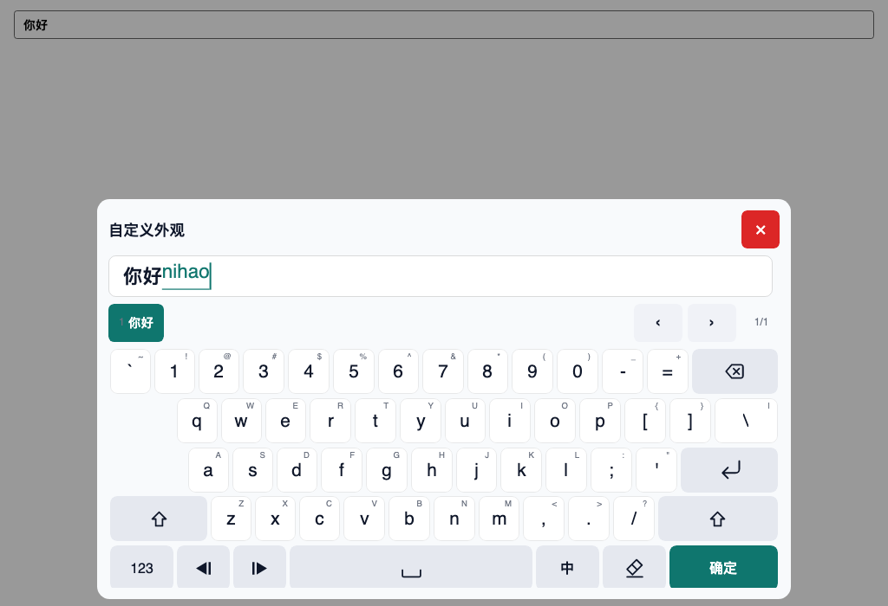

# 外观、尺寸与面板拖动

默认外观使用内置明暗主题。大多数宿主只需要 `TouchKeyboardOptions.Style`
里的少量旋钮；需要精确控制每一个画刷和度量时，仍可直接提供
`TouchKeyboardTheme`。`Style` 会叠加在解析后的主题上，默认值不改变当前外观。

## 一行式外观配置



*`Style.Scale = 0.8`、teal 强调色、白色确定键文字；面板宽度同步缩小，触发长按标题行拖动时已有移动余量。*

```csharp
using Avalonia.Media;
using TouchKeyboard.Avalonia;

KeyboardHost.Configure(options =>
{
    // 整体尺寸：键高、字体、图标、间距、圆角、面板宽度、标题栏/编辑面高度
    options.Style.Scale = 0.85;

    // 在 Scale 之上微调文字和图标
    options.Style.FontScale = 0.95;
    options.Style.IconScale = 1.10;

    // 语义色：确定键、候选选中、光标和组合下划线
    options.Style.AccentColor = Color.Parse("#FF0F766E");
    options.Style.ConfirmTextColor = Colors.White;
    options.Style.SelectedCandidateTextColor = Colors.White;

    // 可选：单独覆盖确定键/候选选中色
    options.Style.ConfirmColor = Color.Parse("#FF0D9488");
    options.Style.SelectedCandidateColor = Color.Parse("#FFCCFBF1");

    // 可选：面板、普通按键和主要文字
    options.Style.PanelColor = Color.Parse("#FFF8FAFC");
    options.Style.KeyColor = Colors.White;
    options.Style.TextColor = Color.Parse("#FF0F172A");

    // 长按标题行拖动面板；默认 true
    options.EnablePanelDrag = true;
});
```

`KeyboardHost` 是 XAML 中 `x:Name` 生成的 code-behind 字段，控件类型是
`TouchKeyboardHost`。

| 配置项 | 默认 | 作用 |
|---|---|---|
| `Style.Scale` | `1.0` | 整体倍率，夹到 `0.6–1.6`；作用于键高、字号、图标、间距、内边距、圆角、面板最大宽度和标题栏/编辑面高度。 |
| `Style.FontScale` | `1.0` | 在整体倍率之上再乘字号；夹到 `0.6–1.6`。 |
| `Style.IconScale` | `1.0` | 在整体倍率之上再乘图标；夹到 `0.6–1.6`。 |
| `Style.AccentColor` | `null` | 确定键、候选选中、光标、组合文字/下划线的强调色。 |
| `Style.ConfirmColor` | `null` | 确定键背景；回退到 `AccentColor`。 |
| `Style.ConfirmTextColor` | `null` | 确定键文字；不填则用主题的前景色。 |
| `Style.SelectedCandidateColor` | `null` | 候选选中背景；回退到 `AccentColor`。 |
| `Style.SelectedCandidateTextColor` | `null` | 候选选中文字；不填则用主题的前景色。 |
| `Style.PanelColor` | `null` | 面板背景。 |
| `Style.KeyColor` | `null` | 普通按键背景；功能键和确定键仍使用各自主题色。 |
| `Style.TextColor` | `null` | 主要文字和候选文字。 |
| `EnablePanelDrag` | `true` | 是否允许长按标题行拖动面板。 |

现有尺寸选项仍然有效，并与 `Style.Scale` 相乘：

| 选项 | 默认 | 说明 |
|---|---|---|
| `KeyHeight` | `0` | 基础键高；`0` 表示按窗口高度自动选 56/64/72。最终键高不小于 44 px。 |
| `MaxPanelWidth` | `1280` | 面板最大宽度；乘以 `Style.Scale`。 |
| `NumericPanelMaxWidth` | `720` | 数字键盘区域最大宽度；乘以 `Style.Scale`。 |

默认 `Style` 不创建新主题，`ResolvedTheme` 仍引用 `TouchKeyboardTheme.Light` /
`.Dark`；只有设置了倍率或颜色时才派生新主题。

## 完整主题控制

`TouchKeyboardTheme` 保留全部画刷和度量，适合品牌化或高对比度主题：

```csharp
options.Theme = new TouchKeyboardTheme
{
    PanelBackground = new SolidColorBrush(Color.Parse("#FF0B1220")),
    KeyBackground = new SolidColorBrush(Color.Parse("#FF111827")),
    ActionKeyBackground = new SolidColorBrush(Color.Parse("#FF1F2937")),
    PrimaryKeyBackground = new SolidColorBrush(Color.Parse("#FF14B8A6")),
    CandidateSelectedBackground = new SolidColorBrush(Color.Parse("#FF0F766E")),
    Text = Brushes.White,
    CandidateFontSize = 20
};
```

`Style` 会叠加在这个主题之上：先解析显式 `Theme` 或窗口明暗预设，再应用
`Style.Scale`、字体/图标倍率和语义色。完全自定义时可以把 `Style` 保持默认，
只改 `Theme`。

## 面板拖动

- 在标题行（标题、单位、错误信息和关闭键所在行）**长按约 420 ms** 后进入拖动；
  普通点按不会移动面板。
- 拖动范围被限制在当前宿主窗口内；不会超出窗口边界。
- 面板没有可移动余量时（例如尺寸已经占满窗口），长按不会产生移动。
- 缩小 `Style.Scale`、`MaxPanelWidth` 或 `NumericPanelMaxWidth` 后会自然出现移动空间。
- 位置在本次宿主生命周期内保留，窗口尺寸变化时自动夹回窗口内。
- `KeyboardHost.ResetPanelPosition()` 可恢复默认底部居中位置。
- 关闭键仍按原方式工作；在关闭键上长按不会触发拖动。

拖动只影响渲染位置，不改变面板布局、会话状态或目标控件。

## 演示程序

`samples/TouchKeyboard.Demo` 展示全部输入档位、两套全键盘形态、明暗主题、
缩放滑杆和语义色选择。运行方法和可尝试的检查项见
[Demo README](../samples/TouchKeyboard.Demo/README.md)。

## 公共 API 一览

| 类型/成员 | 层次 | 用途 |
|---|---|---|
| `TouchKeyboardOptions.Style` | Avalonia | 少量尺寸/颜色旋钮，叠加在主题上。 |
| `TouchKeyboardOptions.Theme` | Avalonia | 完整主题；`null` 跟随窗口明暗。 |
| `TouchKeyboardOptions.KeyHeight` / `MaxPanelWidth` / `NumericPanelMaxWidth` | Avalonia | 基础尺寸；再乘 `Style.Scale`。 |
| `TouchKeyboardOptions.EnablePanelDrag` | Avalonia | 标题行长按拖动开关。 |
| `TouchKeyboardHost.ResetPanelPosition()` | Avalonia | 复位面板位置。 |
| `TouchKeyboardStyle` | Avalonia | `Scale`、`FontScale`、`IconScale` 和语义色。 |
| `TouchKeyboardTheme` | Avalonia | 全部画刷/字体/圆角/间距/候选栏度量。 |
| `IImeEngine` / `PinyinImeEngine` 等 | Core / 语言包 | 可选拼音能力；与外观配置正交。 |

Core 仍然不引用 Avalonia、字体、画刷或平台 API；外观 API 全部留在
`TouchKeyboard.Avalonia`。

## 使用建议

- 在第一次打开面板前完成 `Configure`；运行中再次调用 `Configure` 可以更新外观，
  但 IME 选项只影响下一次会话。
- 触摸设备上建议 `Style.Scale >= 0.8`；键高、确定键、候选/翻页目标仍不小于 44 px。
- 颜色覆盖只提供语义背景；文字对比度由 `ConfirmTextColor` /
  `SelectedCandidateTextColor` / `TextColor` 或完整 `Theme` 负责。
- 需要按字段切换外观时，在打开前调用 `Configure`；不要在每个字段上重复创建主题。
