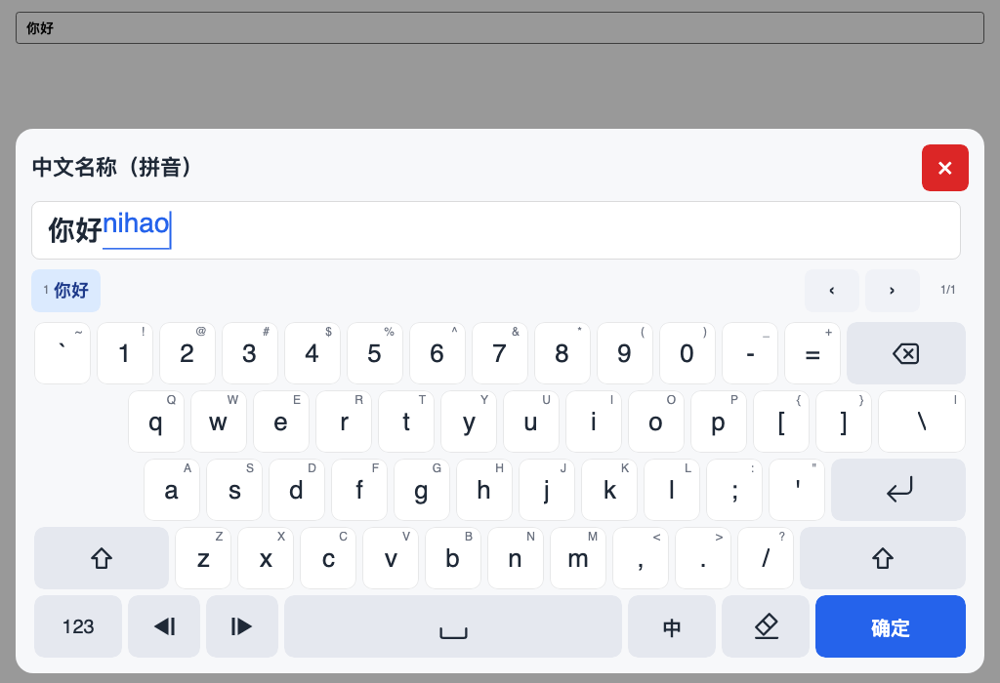
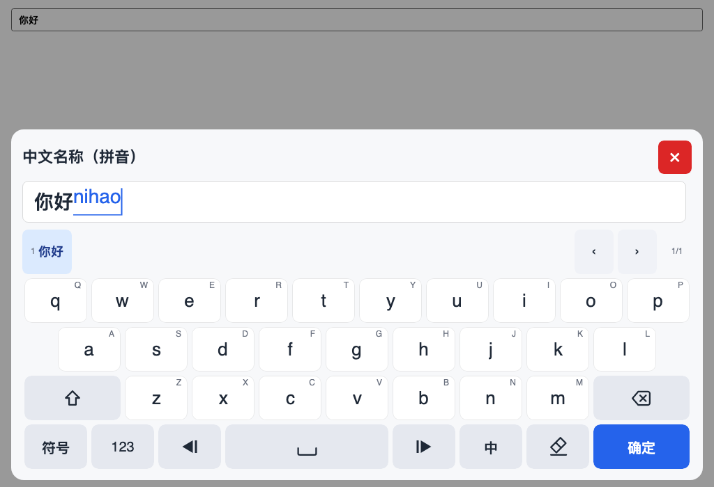
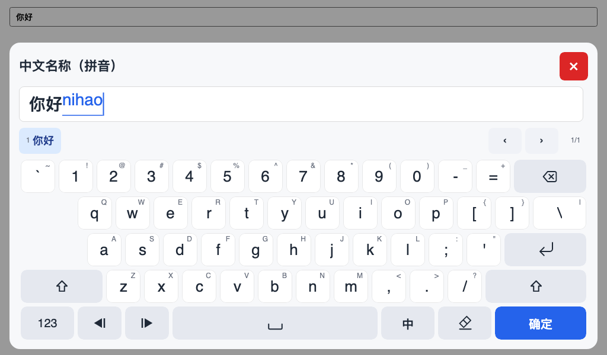

# 中文输入（可选托管拼音 IME）

中文输入是**可选能力**：框架能力在 `TouchKeyboard.Avalonia`，输入逻辑在
`TouchKeyboard.Core`，语言数据在独立的 NuGet 包。不装语言包、不调用 `UseIme`
时，键盘与无 IME 状态完全一致；不会出现 IME 键或候选栏。

- 路线：纯托管拼音（全拼、分词/整句、常用简拼），不接系统 IME，不做按键注入。
- 包：`TouchKeyboard.Ime.Pinyin`（常用约 2 万词）和可选的
  `TouchKeyboard.Ime.Pinyin.Extended`（约 10 万词）。
- 不引入 `TouchKeyboard.Avalonia.Ime`：候选栏、IME 键和组合态渲染属于通用
  Avalonia 框架支持。



*AnsiStyle + `text` 档位：组合中；Space 5.5 单位，右侧 1.5 单位中/英键，候选栏 44 px（AnsiStyle）。*



*PhoneHybrid + 拼音：候选栏作为首行（高度等于键高），下面 4 行字母；与 5 行符号页等高。*



*同一状态在 1024×600 窗口、自动 56 px 键高下不溢出。*

## 安装与一行接入

```bash
dotnet add package TouchKeyboard.Avalonia
dotnet add package TouchKeyboard.Ime.Pinyin
```

```csharp
using TouchKeyboard.Avalonia;
using TouchKeyboard.Ime.Pinyin;

KeyboardHost.Configure(options =>
{
    options.UseIme(new PinyinImeEngine());
});
```

`text` 档位自动获得中/英键和候选栏；数字、日期、IP、密码、ASCII 标识档位完全
不受影响。扩展包只换引擎类型：

```csharp
using TouchKeyboard.Ime.Pinyin.Extended;

KeyboardHost.Configure(options => options.UseIme(new ExtendedPinyinImeEngine()));
```

引擎由宿主显式创建；没有反射、程序集扫描、DI 注册或语言市场。引擎不可变，
加载词典后线程安全，建议整个应用共享一个实例。

`KeyboardHost` 是 XAML 中 `x:Name` 生成的 code-behind 字段，控件类型是
`TouchKeyboardHost`。

## 选项

| 选项 | 默认 | 说明 |
|---|---|---|
| `Ime.Engine` | `null` | 语言包引擎；`null` 时不启用 IME。 |
| `Ime.DefaultEnabled` | `null` | `null` = 有引擎时默认中文；`false` = 默认英文。 |
| `Ime.RememberMode` | `true` | 应用会话内记住最后一次中/英选择，切换字段沿用；重启重置。 |
| `Ime.CandidatePageSize` | `9` | 每页候选数上限，Core 会夹到 1–9；Avalonia 会按候选行可用宽度自动缩小页大小。 |
| `Ime.MaxCompositionLength` | `32` | 原始拼音最大长度，Core 会夹到 8–64。 |
| `Ime.FullWidthPunctuation` | `true` | 中文模式下是否调用引擎的全角标点映射。 |

IME 键的文案跟随 `TouchKeyboardOptions.KeyLanguage`：中文键面显示 `中/英`，英文键面显示 `CN/EN`。全英文宿主可以不安装拼音包、不调用 `UseIme`，也可以保留引擎但把 `KeyLanguage` 设为 `English`；键位几何和 Space 宽度不受语言选项影响。

`DefaultEnabled=false` 只改变初始状态，不改变布局宽度：有引擎且档位允许时，
IME 键始终存在，中/英切换不改变 Space 宽度。

## 行为矩阵

| 档位 / 状态 | IME 键 | 候选栏 | Space |
|---|---|---|---|
| 无引擎（任何档位） | 无 | 无 | AnsiStyle 7.0 / PhoneHybrid 3.5 |
| 有引擎 + `text` | 有（中文键面 中/英，英文键面 CN/EN；英文输入模式也保留） | 有；AnsiStyle 44 px，PhoneHybrid 首行 = 键高 | AnsiStyle 5.5 / PhoneHybrid 2.5 |
| 有引擎 + 数字/日期/IP/密码/ASCII | 无 | 无 | 不适用（数字键盘）/ 原布局 |
| 有引擎 + `text` 临时切到数字键盘 | 无（数字键盘） | 保留空行，避免面板跳高 | 数字键盘没有 Space |

`AllowsIme` 只由档位决定：内置档位中只有 `text` 返回 `true`。自定义档位可显式
`public override bool AllowsIme => true;`，但还必须允许全键盘；纯数字档位即使
误开 `AllowsIme` 也不会出现 IME 键或候选栏。

## 按键与提交规则

| 操作 | 组合中 | 非组合 |
|---|---|---|
| `a–z` / `A–Z` | 追加小写拼音，刷新候选 | 正常插入 |
| `1–9` | 选中当前页第 N 个候选并提交 | 正常插入数字 |
| `0` | 忽略 | 正常插入 |
| `空格` | 提交当前候选；无候选则提交原始拼音 | 插入空格 |
| `回车` / `确定` | 先提交候选，再校验/提交字段 | 提交字段 |
| `退格` | 删除一个拼音字母 | 删除光标前字符 |
| `←` / `→` | 移动候选高亮，跨页环绕 | 移动光标 |
| `↑` / `↓`（物理键盘） | 上一个/下一个候选 | 数字步进（原行为） |
| 中/英 | 先提交候选，再切换 | 切换 |
| `Shift` / 模式 / 页面 | 先提交候选，再切换 | 正常切换 |
| 标点/符号 | 先提交候选，再插入（中文模式全角映射） | 正常插入 |
| 清空 | 清空组合与缓冲 | 清空缓冲 |
| Esc / 遮罩 / 关闭 | 丢弃组合和会话，不写回 | 关闭会话 |

- 组合态只存在于 Core 的 `KeyboardSession`，`KeyboardState.Ime` 是唯一渲染源。
- 组合中的拼音不写入字段；只有提交候选后才进入 `State.Text`。
- 候选插入超过字段最大长度时保留组合，并显示 `MaxLengthExceeded`。
- 引擎无候选时 `PageCount == 0`，空格/回车按原始拼音提交。
- 标点映射只在中文模式且未组合时生效；`FullWidthPunctuation=false` 完全关闭。
- 关闭、遮罩和 Esc 始终丢弃，不写回。

## 符号页与中英文标点

PhoneHybrid 符号页接入 IME 后，功能行的清空键位变成中/英切换键；没有引擎时仍为
清空键。切换键沿用 1 单位槽位，功能行仍为 8 键。

IME 中文模式下，符号页中有映射的键帽显示全角标点，例如 `.`→`。`、`,`→`，`、
`?`→`？`、`!`→`！`，以及方括号和花括号对。按键命令仍插入 ASCII 源字符，由 Core
调用引擎的 `TryMapPunctuation` 映射，因此字段校验、最大长度和提交归一化与普通
按键输入一致。英文模式或 `Ime.FullWidthPunctuation = false` 时键帽保持 ASCII。

`Ime.FullWidthPunctuation` 同时控制输入映射和符号页键帽；切换中/英会立即重建布局
并更新键帽，不改变行宽或页面高度。

## 候选栏与主题

候选栏是编辑面与键盘之间的固定预留行。AnsiStyle 默认 44 px；PhoneHybrid 的
26 键主页和通用数字页把候选栏作为五行的第一行，高度等于键高（56/64/72），因此
26 键主页（候选行 + 4 行按键）与符号页（5 行按键）总高度一致；符号页没有 IME
槽位，隐藏候选栏。数字专用档位不显示候选栏，并把键盘区收紧为 4 行。组合开始/
结束、中英切换、翻页都不改变同一种模式下的面板高度。

它只包含编号候选、上一页/下一页和页码；拼音输入本身显示在编辑窗口中，候选行
左侧不再重复拼写文本。无候选时显示提示，未组合时显示弱化的模式提示。候选按钮按
文字自适应，不使用省略号；所有候选键保持自然宽度，不拉伸填满候选行。候选
行不出现滚动条：Avalonia 会按可用宽度自动缩小 Core 每页候选数（最多 9、最少 1），
翻页只通过切页按键完成。切页按钮宽度 56 px；触摸目标不小于 44 px，不进入 Tab
焦点链。

主题新增成员（明暗预设都有值）：

| 成员 | 用途 |
|---|---|
| `CandidateBarHeight` | AnsiStyle 候选栏高度，默认 44；PhoneHybrid 首行模式自动使用键高。宿主可改，但同一会话内不变。 |
| `CandidateBackground` | 候选按钮底色。 |
| `CandidateSelectedBackground` | 默认/选中候选高亮。 |
| `CandidateText` / `CandidateSelectedText` | 候选文字。 |
| `CandidateMutedText` | 页码、提示。 |
| `CompositionText` | 编辑面组合文本。 |
| `CompositionUnderline` | 组合下划线。 |
| `CandidateCornerRadius` / `CandidateFontSize` | 候选按钮外观。 |
| `CompositionUnderlineThickness` | 组合下划线粗细。 |

默认 `TouchKeyboardEditor` 会在光标处内联绘制组合拼音和下划线，并把光标放在
组合末尾。候选栏不再重复显示拼音；自定义 `IEditorSurface` 不实现组合渲染时，
字段仍可正常提交，但组合文本只由该编辑面自行决定是否显示。`IEditorSurface`
契约没有新增成员。

## 本地化与无障碍

内置 zh-CN / en-US 增加 `key.ime.*`、`ime.candidates`、`ime.previous`、
`ime.next`、`ime.no-candidate`、`ime.hint.chinese`、`ime.hint.english`、
`ime.candidate.name`、`ime.page` 和 `ime.composing`。IME 键、候选按钮和翻页按钮
都有本地化无障碍名称和 `AutomationControlType.Button`；候选栏整体名为“候选词”。

## 物理键盘

`HandlePhysicalKeyboard = true` 时，物理键盘文本也走同一个会话：中文模式下字母
进入组合态，`Enter` 提交字段，`Esc` 关闭丢弃。系统 IME 可能先于宿主处理按键，
这是平台行为；需要系统 IME 的宿主应关闭 `HandlePhysicalKeyboard` 或使用自己的
编辑面。触摸输入仍是主路径。

## 包体积与性能

语言包体积由词典决定：常用包较小，扩展包约为常用包的数倍；词典在首次查询时
加载，之后复用。实际加载时间、查询速度和内存占用取决于设备、文件系统、冷启动
和词典大小，不构成性能保证。

## 数据来源与许可

- 代码：MIT。
- 字音：Unihan `kMandarin`（Unicode License V3）。
- 词表/词频：jieba `dict.txt`（MIT，版权 2013 Sun Junyi）。
- 词组读音和多音字覆盖：由本项目生成并维护（MIT）。

两个语言包都携带 `NOTICE`，列出源、快照 SHA-256 和完整许可文本。词典构建脚本
在 `tools/build-pinyin-dict.py`。不使用 CC-BY-SA、GPL/AGPL、专有或来源不明的
数据。软件和数据按现状提供，不承诺候选质量、覆盖率、性能或稳定性。

## 故障排查

| 现象 | 检查 |
|---|---|
| 没有 CN/EN（中/英）键或候选栏 | 是否调用了 `UseIme(...)`；字段档位是否为 `text`；是否安装了对应语言包；`KeyLanguage` 是否设置了英文键面。 |
| 中文显示方框 | 默认已使用平台 CJK 回退链；若系统缺少这些字体，安装 CJK 字体或通过 `options.Style.FontFamily` 指定可用字体。Windows 可用 Microsoft YaHei UI，macOS 用 PingFang SC，Linux 用 Noto Sans CJK SC。 |
| 候选栏让面板太高 | 降低 `KeyHeight`；PhoneHybrid 首行候选栏会随键高缩短，数字专用档位已收紧为 4 行。 |
| 中英切换后键盘变宽/变窄 | 不应发生；有引擎且档位允许时 IME 键常驻。检查是否在切换字段。 |
| 拼音提交后长度错误 | 字段 `MaxLength` 太小；退回较短候选或删减缓冲。 |
| 系统 OSK 仍弹出 | 默认 `TouchKeyboardEditor` 不触发 OSK；自定义 `IEditorSurface` 使用真实 `TextBox` 时可能触发，需宿主自行处理。 |
| 查询慢或内存高 | 只共享一个引擎实例；扩展包词典更大，按需安装。 |
