# Layout reference

**English** · [简体中文](layouts.zh.md)

Every surface is immutable data built by `KeyboardLayouts.Full`,
`KeyboardLayouts.GeneralNumeric` and `KeyboardLayouts.ProfileNumeric`. The core
describes keys, unit widths, grid cells and semantic glyphs; the Avalonia frontend
draws them and never introduces UI types into the core. Rows share one unit grid:
gaps are half-margins inside the unit columns, so a key at the same unit offset
starts at the same x on every row of a surface.

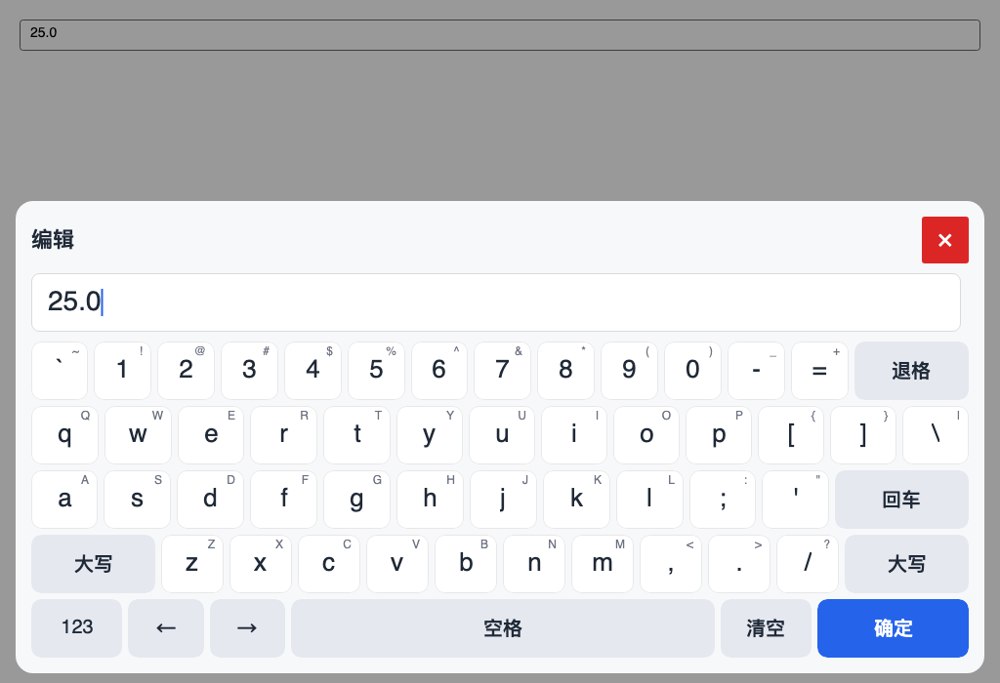

*AnsiStyle, the default full keyboard (1024×700 headless render).*

## Full keyboard geometry

`FullKeyboardLayoutKind` selects one of two geometries. `AnsiStyle` is the default;
`PhoneHybrid` is the retained alternative.

### AnsiStyle

Five rows, every row exactly **15 units**. Tab and Caps are commandless
`KeyStyle.Spacer` cells: they keep the geometry aligned, never take a press and
never enter the accessibility tree. There is no IME spacer: with no IME key, Space
fills the slot.

> **Space and IME:** with no IME key, Space fills the former IME slot
> (`AnsiStyle` 7.0 units, `PhoneHybrid` 3.5). When an IME engine is configured and
> the profile allows IME, Space returns to its base width (5.5 / 2.5) and the slot
> holds a real `ime.toggle` key. The key reads 中/英 in the Chinese surface and
> CN/EN in the English surface; it is present even in English input mode, so
> toggling the IME mode does not change the width. See [ime.md](ime.md).

| Row | Keys and widths | Total |
|---|---|---|
| 0 | `` ` ``1 + `1..0`10 + `-`1 + `=`1 + `⌫`2 | 15 |
| 1 | **Tab spacer 1.5** + `Q..P`10 + `[`1 + `]`1 + `\`1.5 | 15 |
| 2 | **Caps spacer 1.75** + `A..L`9 + `;`1 + `'`1 + `Enter`2.25 | 15 |
| 3 | `Shift`2.25 + `Z..M`7 + `,` `.` `/`3 + `Shift`2.75 | 15 |
| 4 | `123`1.5 + `←`1.25 + `→`1.25 + `Space`5.5 (**7.0 without IME**) + **`ime.toggle` 1.5 (only with IME)** + `Clear`/清空 1.5 + `Confirm`/确定 2.5 | 15 |

> The render above shows the no-IME state with Space expanded over the slot. With an
> IME engine and the `text` profile, the bottom row instead shows Space 5.5 plus a
> 1.5-unit `ime.toggle` key (中/英 or CN/EN); row total stays 15.


Named keys use the selected `KeyboardLanguage`: the tables below show the Chinese
legends for clarity; an English surface reads `Symbols`, `Clear`, `Confirm`,
`CN`/`EN` instead of 符号, 清空, 确定, 中/英. Letter, digit and symbol keys are
literal and do not change with the language.

AnsiStyle keeps the complete US ANSI symbol set on its main page and Shift layer,
so it has no separate symbol page.

### PhoneHybrid

Four phone-style letter rows with no number row; digits and symbols are reached
from the bottom row. A 10-unit bottom row is the design width.

| Row | Keys and widths | Total |
|---|---|---|
| 0 | `Q W E R T Y U I O P` | 10 |
| 1 | **inset 0.5** + `A S D F G H J K L` + **inset 0.5** | 10 |
| 2 | `Shift`1.5 + `Z X C V B N M`7 + `⌫`1.5 | 10 |
| 3 | `Symbols`/`符号`1 + `123`1 + `←`1 + `Space`2.5 (**3.5 without IME**) + `→`1 + **`ime.toggle` 1 (only with IME)** + `Clear`/清空 1 + `Confirm`/确定 1.5 | 10 |

The first letter row fixes the key width at one unit. The home row is inset by half
a unit on both sides, so `A` sits half a key right of `Q`; the Z row starts after
the 1.5-unit Shift, so `Z` lines up with `S`. Caret keys flank the space bar, which
fills the remaining width; the symbol entry sits left of the numeric entry. With an
IME engine and the `text` profile, Space becomes 2.5 and a 1-unit `ime.toggle`
sits between the right caret key and Clear/清空; the row stays 10 units. The symbol page
has no IME slot and belongs to the full keyboard; the numeric keypad never opens it.

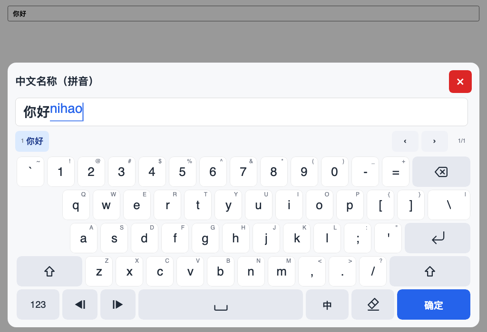

*AnsiStyle with the optional pinyin IME: composition in the editor, a fixed
candidate row, Space 5.5 and a 1.5-unit IME key (中/英 / CN/EN).*

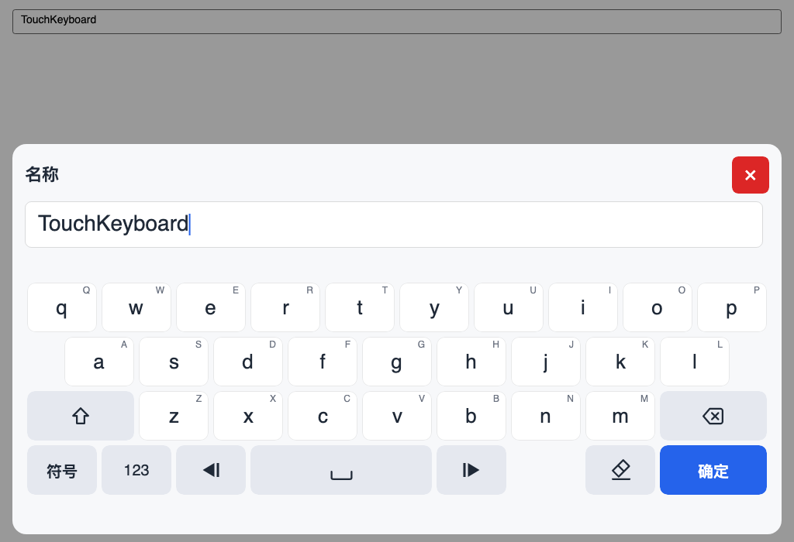

*PhoneHybrid main page.*

When an IME session is active, the candidate row is the first of the five rows on
the main page: candidate row (key height) + four letter rows = the same total height
as the five-row symbol page. The candidate row is hidden on the symbol page, which
has no IME slot. Switching to the general numeric keypad keeps the candidate row
(empty) and the same total height; a numeric-only profile uses a compact four-row
keyboard area.

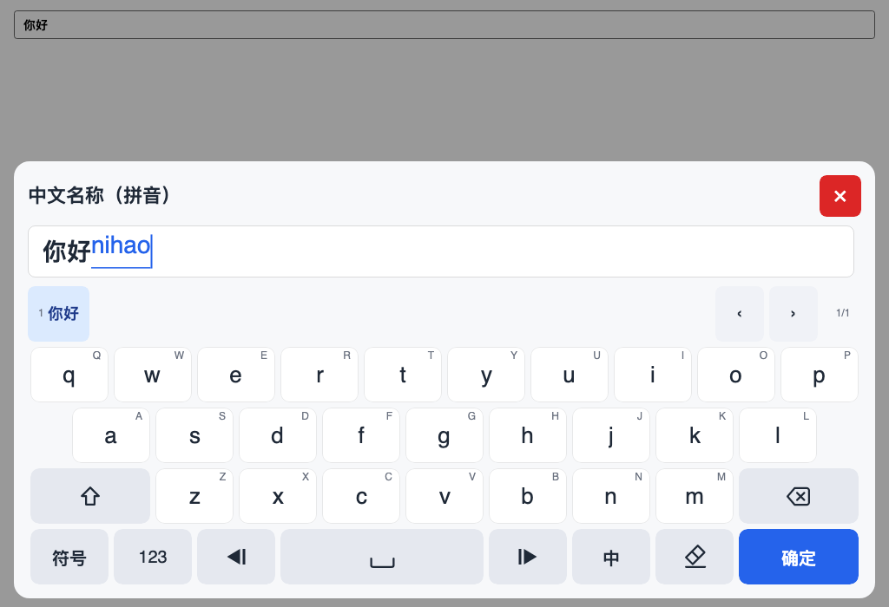

*PhoneHybrid + pinyin: candidate first row, four letter rows, no height jump when
switching to the symbol page or numeric keypad.*

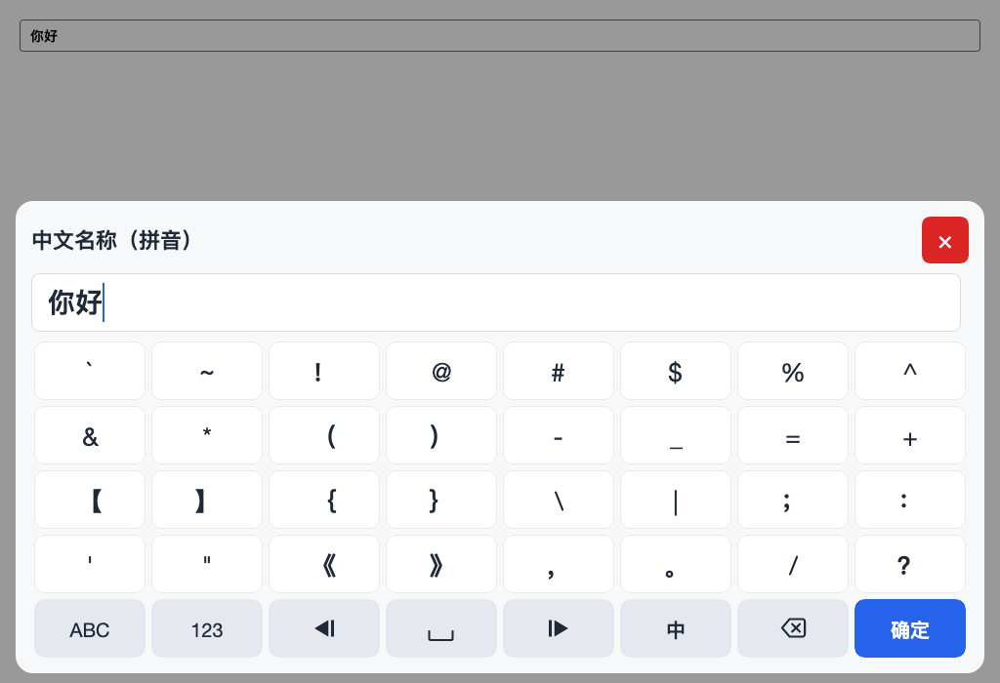

*PhoneHybrid symbol page: five key rows and no candidate row, matching the main
page height.*

### Symbol page

The symbol page is a full-keyboard page (`FullKeyboardPage.Symbols`): a 4×8 grid
of one-unit symbol keys plus a separate 8-key function row. It carries the full
32-symbol US ANSI set, so the PhoneHybrid symbol entry no longer needs a second
symbol layer. `ABC` returns to the main page, `123` switches to the numeric
keypad, and Clear sits immediately left of Backspace. Every one of the 40 cells
is one unit wide; the four symbol rows and the function row share the same grid.

```text
` ~ ! @ # $ % ^
& * ( ) - _ = +
[ ] { } \ | ; :
' " < > , . / ?
ABC 123 ← Space → Clear ⌫ Confirm
```

Backtick and tilde are the first two symbols; the eight ANSI symbols that were
missing from the old page — apostrophe, double quote, less-than, greater-than,
comma, period, slash and question mark — are the last eight keys in that order.

With an IME engine and an IME-capable profile, the Clear slot becomes the IME
toggle (`中/英` or `CN/EN`) instead of a Clear key; the toggle keeps the 1-unit
slot, so the row total stays 8. Without an engine, the slot remains Clear. This
is why the IME screenshot below shows a toggle where the plain symbol page shows
Clear.

In Chinese mode, symbol caps that the engine maps show the mapped punctuation
(for example `.`→`。`, `,`→`，`, `?`→`？`, `!`→`！`, and the bracket/brace
pairs); the key command still inserts the ASCII source and the session performs
the mapping, so field validation and commit normalization are unchanged. In
English mode, or when `FullWidthPunctuation = false`, the caps stay ASCII. The
mapping is owned by the engine, not hard-coded in the layout.

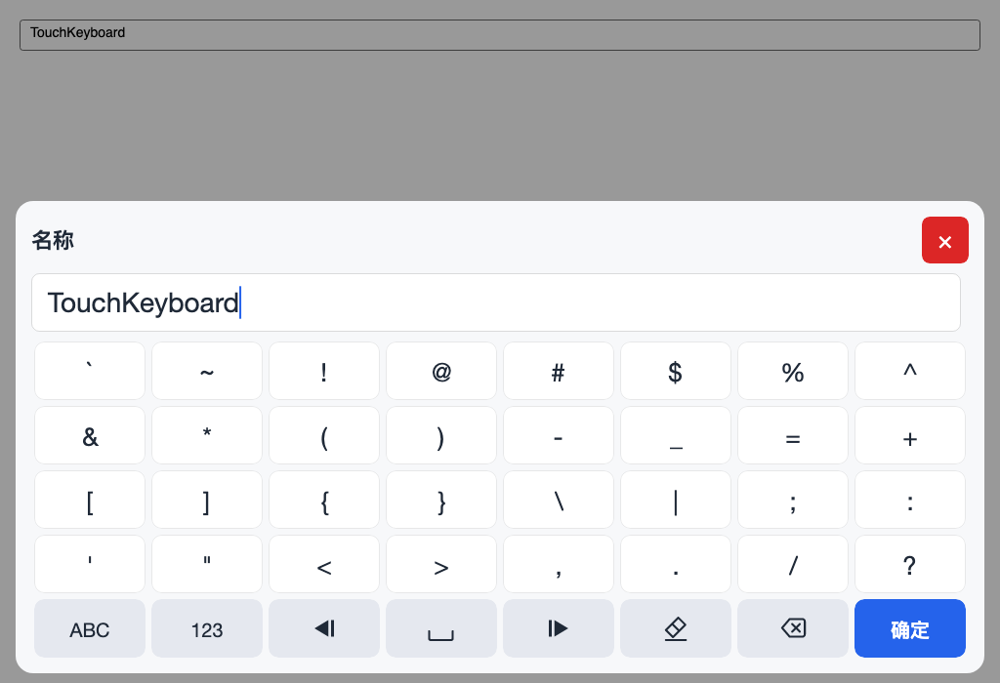

*PhoneHybrid symbol page.*

## Numeric keypad

`NumericKeypadLayoutKind` selects the numeric surface. `Numpad` is the default and
the only enabled surface; `Sequence` is retained but not enabled for any built-in
profile.

### Numpad

The Numpad is a real 5×4 cell grid where every key is one unit:

```text
[L0 ▲/+]        [7] [8] [9] [R0 ⌫]
[L1 ▼/−]        [4] [5] [6] [R1 Clear]
[L2 ABC/±/empty] [1] [2] [3] [R2 scenario/empty]
[L3 ←]          [→] [0] [. , / : / empty] [Confirm]
```

- `L0`/`L1` step the digit left of the caret when the scenario enables step keys,
  and insert `+`/`−` as characters when it does not.
- `L2` is the ABC key for the general surface, `±` for signed scenarios, and
  empty otherwise.
- `R2` is reserved for scenario keys; no built-in scenario fills it.
- The bottom separator slot takes `.`, a date/IP separator or `:`, or stays empty.

Empty slots are not disabled buttons. They change the geometry:

| Situation | Result |
|---|---|
| Bottom separator slot empty | `0` spans two columns (`ColumnSpan = 2`) |
| Right row-2 slot empty | `Confirm` spans two rows (`RowSpan = 2`) |
| Right row-2 slot filled | `Confirm` occupies the bottom-right cell only |
| Left row-2 slot empty | Only the left column changes; Confirm keeps its height |

`NumpadSlots` maps the scenario to those slots. `NumpadSlots.From(options)` derives
them from an `InputProfile.NumericKeypad`, and `NumpadSlots.General` is the surface
reached from the full keyboard.

| Scenario | L0/L1 | L2 | R2 | Bottom slot | Zero | Confirm |
|---|---|---|---|---|---|---|
| General numeric (from the full keyboard) | `+` `−` | `ABC` | empty | `.` | 1 column | 2 rows |
| Positive integer | `▲` `▼` | empty | empty | empty | 2 columns | 2 rows |
| Signed integer | `▲` `▼` | `±` | empty | empty | 2 columns | 2 rows |
| Positive decimal | `▲` `▼` | empty | empty | `.` | 1 column | 2 rows |
| Signed decimal | `▲` `▼` | `±` | empty | `.` | 1 column | 2 rows |
| Date | `▲` `▼` | empty | empty | `/` or `.` | 1 column | 2 rows |
| IPv4 | `▲` `▼` | empty | empty | `.` | 1 column | 2 rows |

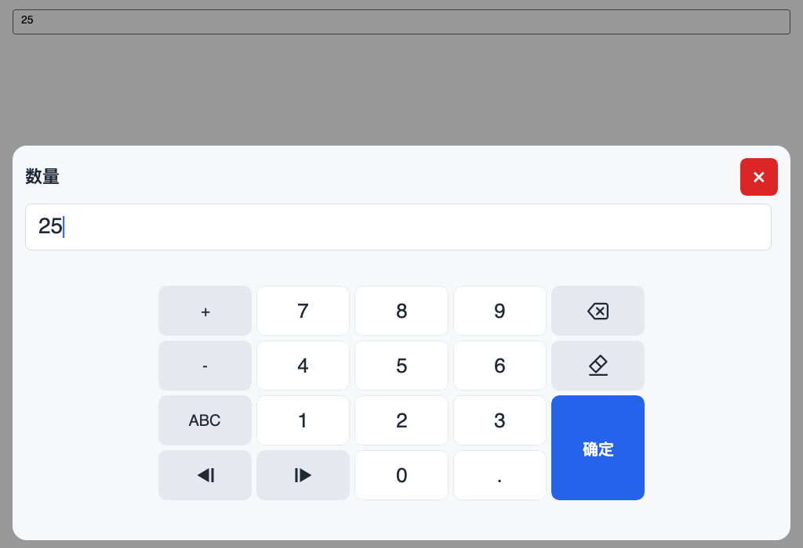

*General Numpad: `+`/`−` characters, `ABC`, decimal point and a two-row Confirm.*

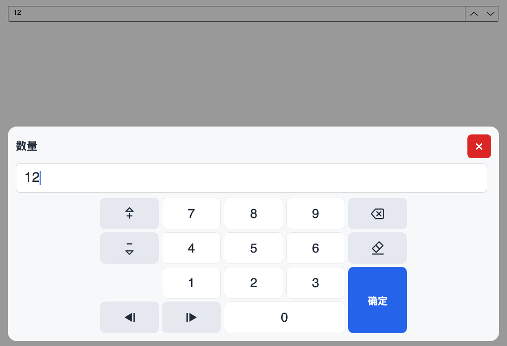

*Positive-integer Numpad: step icons, empty decimal slot so `0` spans two columns,
and a two-row Confirm.*

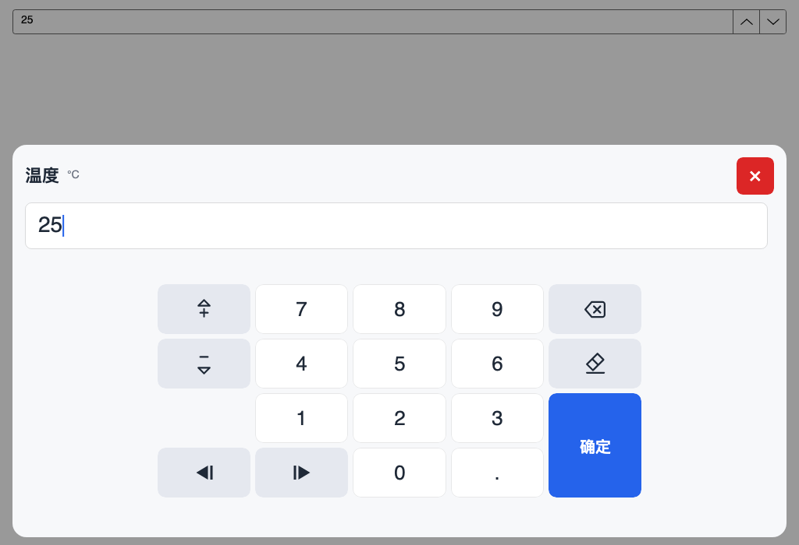

*Positive-decimal Numpad: the decimal point fills the bottom slot, so `0` keeps one
column while Confirm still spans two rows.*

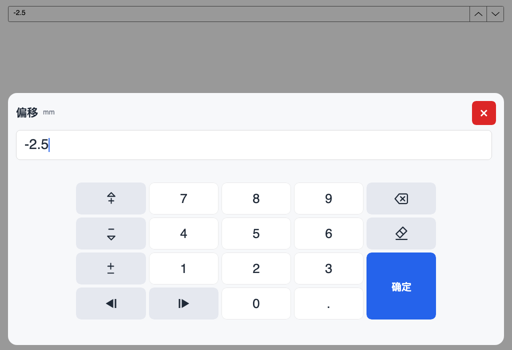

*Signed-decimal Numpad: the sign slot renders a vector ± sized with the digit keys.*


*Profile-restricted numeric keypad: the keyboard area is four rows high and no
candidate row is reserved, so a numeric-only field opens more compactly.*

### Sequence

The retained phone-style 5×6 numeric page (renamed from `Phone`). It can be built
with `KeyboardLayouts.GeneralNumeric(NumericKeypadLayoutKind.Sequence)` and is
reserved for a future sequence-entry scenario. No built-in profile produces it.

## Theming and touch feedback

`TouchKeyboardOptions.Theme` is null by default. The overlay then resolves
`TouchKeyboardTheme.Light` or `.Dark` from the host window's actual theme variant
and re-applies itself when that variant changes, so switching the shell to dark
also switches the keyboard. Set an explicit preset to pin a theme. Close and
confirm keep their contrast in both presets through `DangerKeyForeground` and
`PrimaryKeyForeground`.

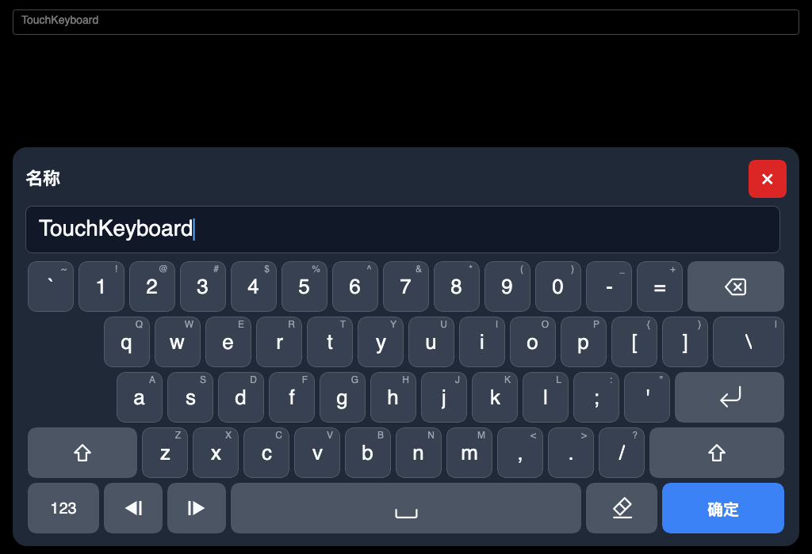

*The same AnsiStyle surface on the dark preset.*

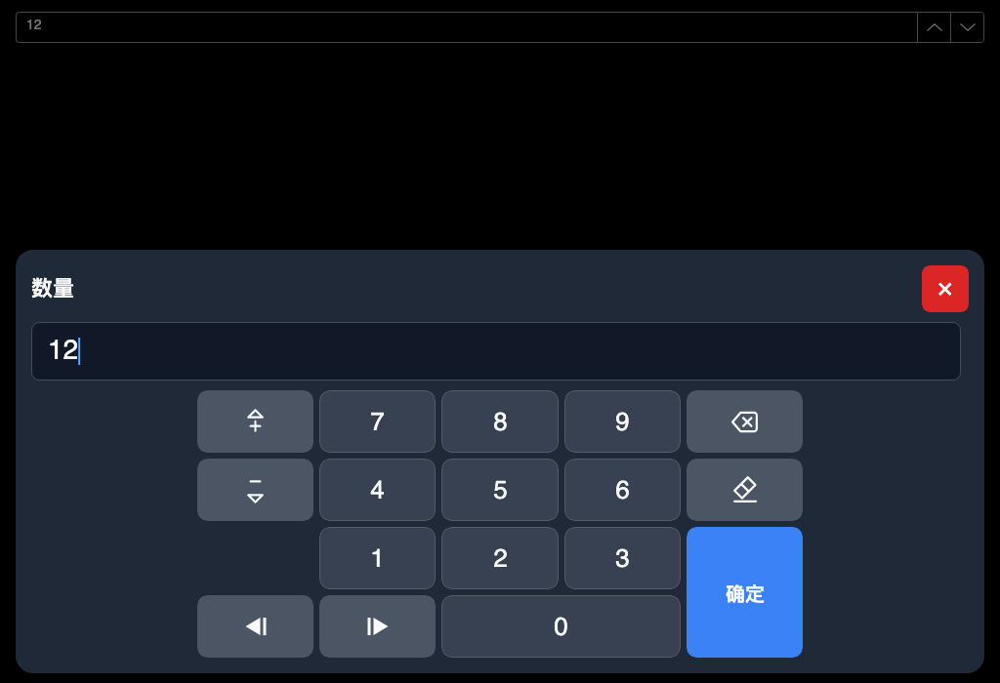

*Dark Numpad; the empty slots still merge into `0` and Confirm.*

Keys and header chrome have no hover state (they are not buttons), so a mouse
hover changes nothing on a touch panel. A press paints a themed overlay and scales
the cap down slightly, which stays visible in both themes.

## Key glyphs

`KeyGlyph` names the semantic icons that frontends draw themselves: backspace
(with the X shifted left inside the tag), clear (an eraser), enter, shift (outline
and filled), caret arrows (a filled triangle plus a caret bar), step arrows (a
triangle paired with a `+`/`−` sign), sign toggle (±), space, password show/hide,
keyboard, symbol, numeric and an IME glyph reserved for a future icon treatment
(the toggle uses the localized 中/英 or CN/EN text; `KeyGlyph.Ime` is retained but unused). Compact
keys use a smaller icon factor. Icon keys keep a localized label; it is the
accessible name and the text fallback when a frontend cannot draw the glyph.

All glyphs are drawn on one 24×24 design canvas. Features keep their relative
position across glyphs: the space bar's bottom line shares the eraser's baseline
(y = 21.5), so the space and clear keys line up, and the password eye sits on the
same canvas as the slashed eye so only the slash changes when visibility toggles.
