# 布局参考

[English](layouts.md) · **简体中文**

每个键盘面都是由 `KeyboardLayouts.Full`、`KeyboardLayouts.GeneralNumeric` 和
`KeyboardLayouts.ProfileNumeric` 构建的不可变数据。Core 层只描述按键、单位宽度、
网格单元和语义图标；Avalonia 前端负责绘制它们，绝不会把 UI 类型带进 Core。所有
行共用一套单位网格：间隙是单位列内部的半宽边距，因此只要单位偏移相同，按键在
同一个键盘面的每一行都会从相同的 x 坐标开始。

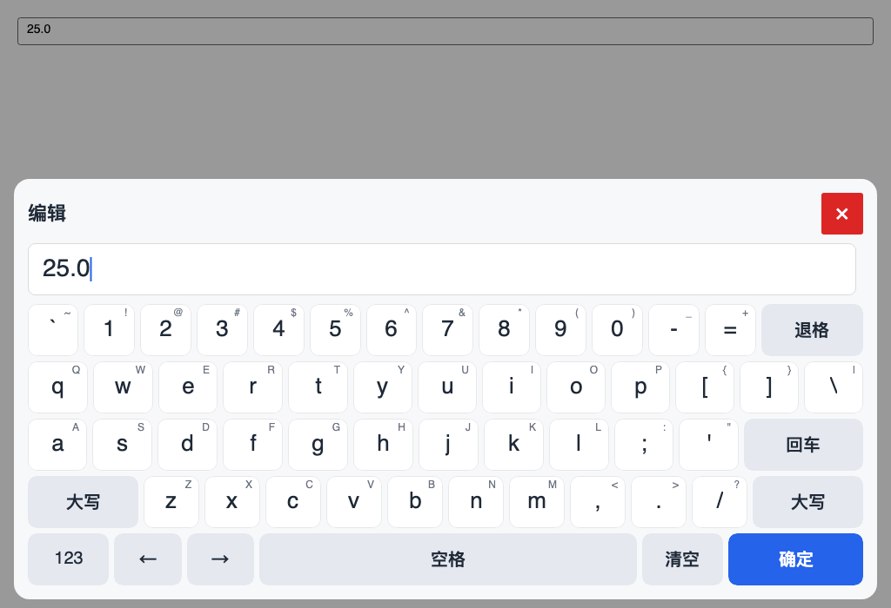

*AnsiStyle，默认全键盘（1024×700 无头渲染）。*

## 全键盘几何

`FullKeyboardLayoutKind` 从两种几何中选一种。`AnsiStyle` 是默认值；`PhoneHybrid`
是保留的备选方案。

### AnsiStyle

共五行，每行恰好 **15 个单位**。Tab 和 Caps 是无命令的 `KeyStyle.Spacer` 单元：
它们只用于保持几何对齐，不响应按压，也不进入无障碍树。这里没有单独的 IME
占位：没有 IME 键时，由 Space 填满该槽位。

> **Space 与 IME：** 没有 IME 键时，Space 填满原来的 IME 槽位
> （`AnsiStyle` 为 7.0 单位，`PhoneHybrid` 为 3.5）。当配置了 IME 引擎且档位
> 允许 IME 时，Space 回到基础宽度（5.5 / 2.5），槽位由一个真正的 `ime.toggle`
> 键占据。该键在中文界面显示 中/英，在英文界面显示 CN/EN；即使处于英文输入
> 模式，该键也依然存在，因此切换 IME 模式不会改变宽度。参见 [ime.md](ime.md)。

| 行 | 按键与宽度 | 合计 |
|---|---|---|
| 0 | `` ` ``1 + `1..0`10 + `-`1 + `=`1 + `⌫`2 | 15 |
| 1 | **Tab 占位 1.5** + `Q..P`10 + `[`1 + `]`1 + `\`1.5 | 15 |
| 2 | **Caps 占位 1.75** + `A..L`9 + `;`1 + `'`1 + `Enter`2.25 | 15 |
| 3 | `Shift`2.25 + `Z..M`7 + `,` `.` `/`3 + `Shift`2.75 | 15 |
| 4 | `123`1.5 + `←`1.25 + `→`1.25 + `Space`5.5（**无 IME 时为 7.0**）+ **`ime.toggle` 1.5（仅配置 IME 时）** + `Clear`/清空 1.5 + `Confirm`/确定 2.5 | 15 |

> 上图展示的是无 IME 状态，Space 扩展覆盖了整个槽位。配置了 IME 引擎并使用
> `text` 档位时，底行则显示 Space 5.5 加上一个 1.5 单位的 `ime.toggle` 键
> （中/英 或 CN/EN）；该行合计仍为 15。


具名键跟随所选的 `KeyboardLanguage`：为便于阅读，本文表格展示中文图例；英文
界面显示的是 `Symbols`、`Clear`、`Confirm`、`CN`/`EN`，而不是 符号、清空、确定、
中/英。字母键、数字键和符号键是字面量，不随语言变化。

AnsiStyle 在主页面和 Shift 层保留了完整的 US ANSI 符号集，因此没有单独的符号页。

### PhoneHybrid

四行手机风格字母键，没有数字行；数字和符号从底行进入。底行宽 10 单位，这就是
设计宽度。

| 行 | 按键与宽度 | 合计 |
|---|---|---|
| 0 | `Q W E R T Y U I O P` | 10 |
| 1 | **内缩 0.5** + `A S D F G H J K L` + **内缩 0.5** | 10 |
| 2 | `Shift`1.5 + `Z X C V B N M`7 + `⌫`1.5 | 10 |
| 3 | `Symbols`/`符号`1 + `123`1 + `←`1 + `Space`2.5（**无 IME 时为 3.5**）+ `→`1 + **`ime.toggle` 1（仅配置 IME 时）** + `Clear`/清空 1 + `Confirm`/确定 1.5 | 10 |

第一行字母键把键宽固定为一个单位。主行（home row）左右各内缩半个单位，因此
`A` 位于 `Q` 右侧半个键的位置；Z 行从 1.5 单位的 Shift 之后开始，因此 `Z` 与
`S` 对齐。光标键分列空格键两侧，空格键填满剩余宽度；符号入口位于数字入口
左侧。配置 IME 引擎并使用 `text` 档位时，Space 变为 2.5，一个 1 单位的
`ime.toggle` 位于右光标键与 Clear/清空之间；该行仍为 10 单位。符号页没有 IME
槽位，并且归全键盘所有；数字键盘永远不会打开它。

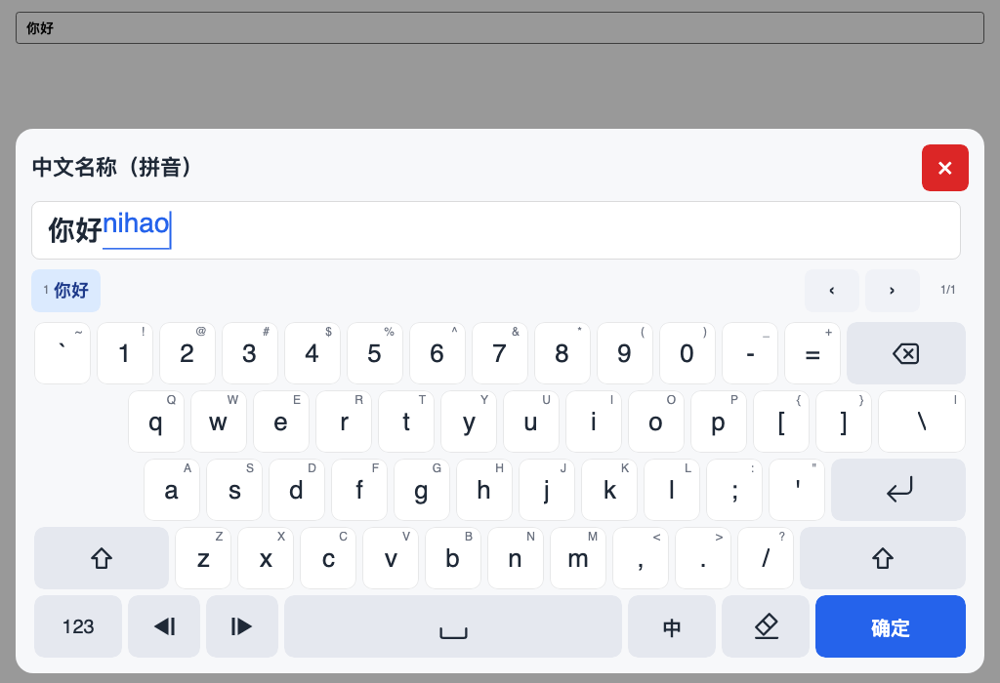

*AnsiStyle 配合可选拼音 IME：编辑器内正在组合，候选栏固定，Space 为 5.5，
右侧是 1.5 单位的 IME 键（中/英 / CN/EN）。*

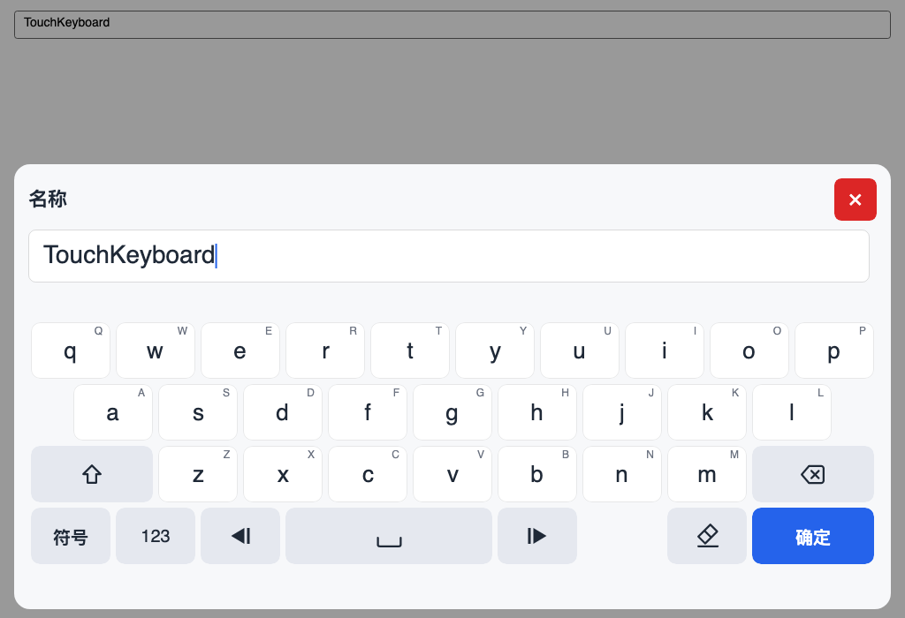

*PhoneHybrid 主页面。*

IME 会话激活时，候选栏是主页面五行中的第一行：候选栏（键高）+ 四行字母 = 与
五行符号页相同的总高度。符号页没有 IME 槽位，候选栏在符号页隐藏。切换到通用
数字键盘时仍保留候选栏（空）和相同的总高度；纯数字档位使用紧凑的四行键盘区。

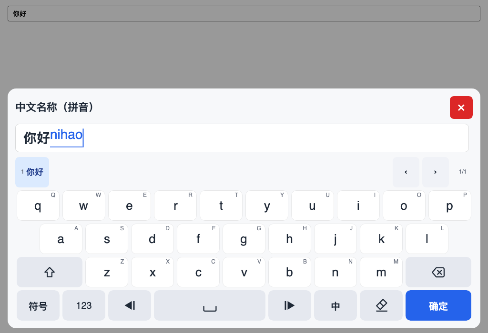

*PhoneHybrid + 拼音：候选栏作为首行，下面四行字母；切换到符号页或数字键盘时
高度不跳变。*

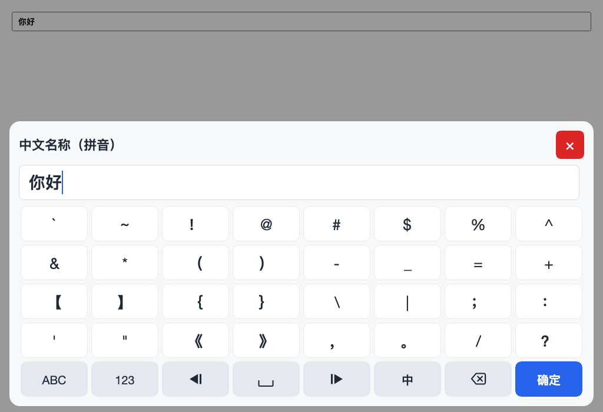

*PhoneHybrid 符号页：五行按键，没有候选栏，与主页面等高。*

### 符号页

符号页是全键盘的一个页面（`FullKeyboardPage.Symbols`）：4 行 × 8 列的单位符号键，
加一行独立的 8 键功能行。它收录完整的 32 个 US ANSI 符号，因此 PhoneHybrid 的
符号入口不再需要第二层符号页。`ABC` 返回主页面，`123` 切换数字键盘，清空键紧挨
在退格左侧。整个页面 40 个格子都是 1 单位宽，4 行符号和功能行共用同一套网格。

```text
` ~ ! @ # $ % ^
& * ( ) - _ = +
[ ] { } \ | ; :
' " < > , . / ?
ABC 123 ← Space → 清空 ⌫ 确定
```

反引号和波浪号是前两个符号；旧页面缺少的 8 个 ANSI 符号——单引号、双引号、
小于号、大于号、逗号、句号、斜杠和问号——按这个顺序排在最后 8 个位置。

接入 IME 引擎且档位允许 IME 时，清空键位变成中/英切换键（`中/英` 或 `CN/EN`），
不再保留清空键；切换键仍占 1 单位，功能行合计保持 8 单位。没有引擎时该槽位仍是
清空键，所以下面的 IME 截图会显示切换键，而普通符号页截图显示清空键。

中文模式下，引擎有映射的符号键帽显示全角标点（例如 `.`→`。`、`,`→`，`、
`?`→`？`、`!`→`！`，以及方括号/花括号对）；按键命令仍插入 ASCII 源字符，由会话
统一映射，因此字段校验和提交归一化不变。英文模式或 `FullWidthPunctuation = false`
时键帽保持 ASCII。映射由引擎负责，不硬编码在布局里。

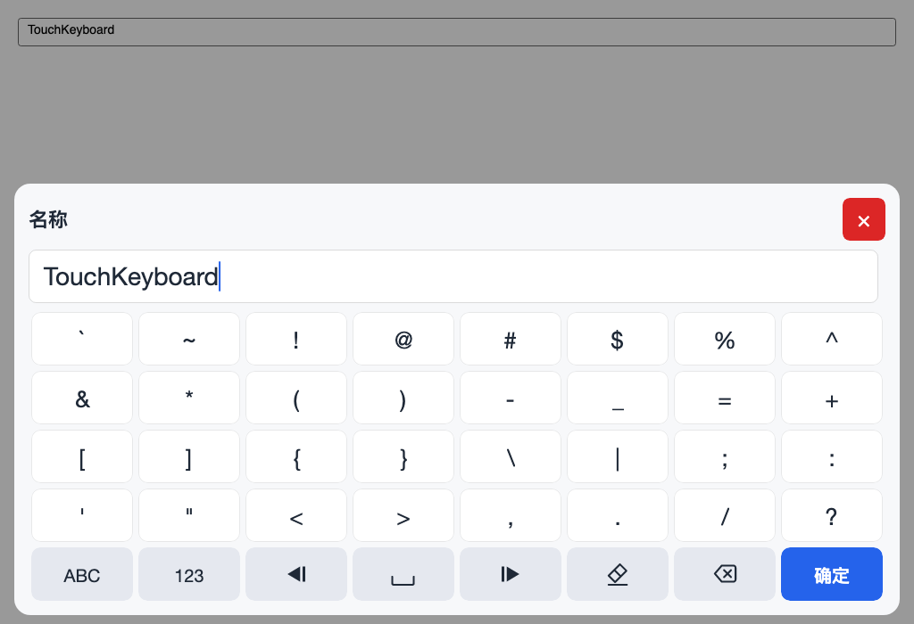

*PhoneHybrid 符号页。*

## 数字键盘

`NumericKeypadLayoutKind` 选择数字键盘面。`Numpad` 是默认值，也是唯一启用的
键盘面；`Sequence` 被保留，但没有任何内置档位启用它。

### Numpad

Numpad 是真正的 5×4 单元格网格，每个键占一个单位：

```text
[L0 ▲/+]        [7] [8] [9] [R0 ⌫]
[L1 ▼/−]        [4] [5] [6] [R1 Clear]
[L2 ABC/±/empty] [1] [2] [3] [R2 scenario/empty]
[L3 ←]          [→] [0] [. , / : / empty] [Confirm]
```

- 当场景启用步进键时，`L0`/`L1` 对光标左侧的数字做步进；未启用时，则把 `+`/`−`
  作为普通字符插入。
- `L2` 在通用键盘面上是 ABC 键，在带符号的场景中是 `±`，其余情况为空。
- `R2` 预留给场景键；目前没有任何内置场景填充它。
- 底部分隔符槽位可以是 `.`、日期/IP 分隔符或 `:`，也可以留空。

空槽位不是被禁用的按钮。它们会改变几何：

| 情况 | 结果 |
|---|---|
| 底部分隔符槽位为空 | `0` 跨两列（`ColumnSpan = 2`） |
| 右侧 R2 槽位为空 | `Confirm` 跨两行（`RowSpan = 2`） |
| 右侧 R2 槽位已填充 | `Confirm` 只占据右下角单元格 |
| 左侧 L2 槽位为空 | 只有左列变化；Confirm 保持原高度 |

`NumpadSlots` 把这些槽位映射到具体场景。`NumpadSlots.From(options)` 从
`InputProfile.NumericKeypad` 推导出这些槽位，`NumpadSlots.General` 则是从全键盘
进入的那个键盘面。

| 场景 | L0/L1 | L2 | R2 | 底部槽位 | 0 键 | Confirm |
|---|---|---|---|---|---|---|
| 通用数字（从全键盘进入） | `+` `−` | `ABC` | 空 | `.` | 1 列 | 2 行 |
| 正整数 | `▲` `▼` | 空 | 空 | 空 | 2 列 | 2 行 |
| 带符号整数 | `▲` `▼` | `±` | 空 | 空 | 2 列 | 2 行 |
| 正小数 | `▲` `▼` | 空 | 空 | `.` | 1 列 | 2 行 |
| 带符号小数 | `▲` `▼` | `±` | 空 | `.` | 1 列 | 2 行 |
| 日期 | `▲` `▼` | 空 | 空 | `/` 或 `.` | 1 列 | 2 行 |
| IPv4 | `▲` `▼` | 空 | 空 | `.` | 1 列 | 2 行 |

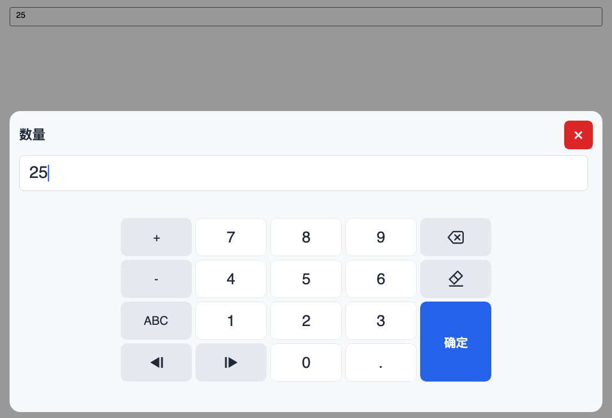

*通用 Numpad：`+`/`−` 字符、`ABC`、小数点，以及跨两行的 Confirm。*

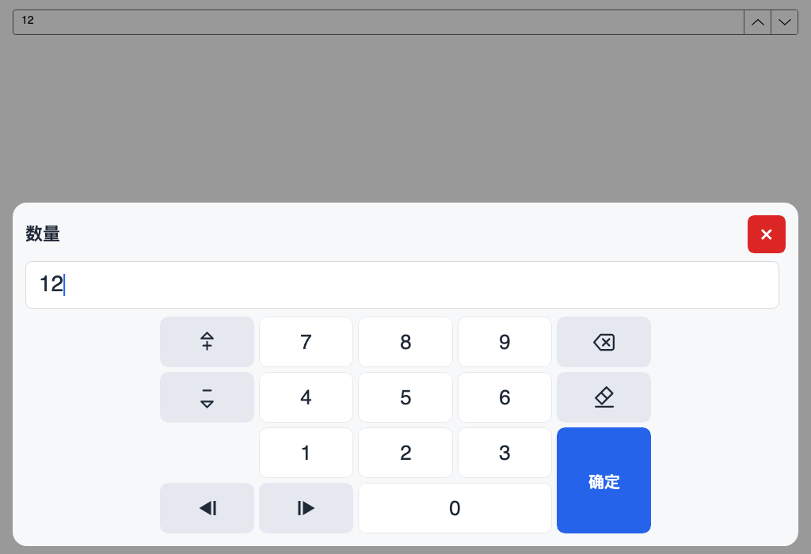

*正整数 Numpad：步进图标、空的小数槽位（因此 `0` 跨两列），以及跨两行的
Confirm。*

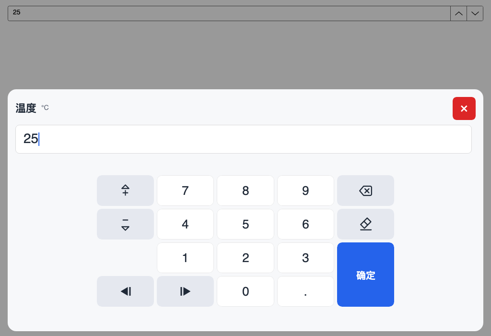

*正小数 Numpad：小数点填满底部槽位，因此 `0` 只占一列，而 Confirm 仍然跨
两行。*

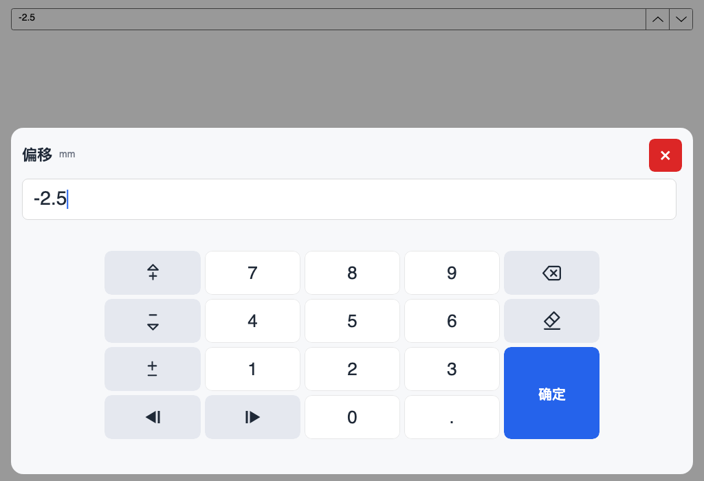

*带符号小数 Numpad：符号槽位绘制与数字键同尺寸的矢量 ±。*


*档位限定的数字键盘：键盘区高度为四行，且不预留候选栏，因此纯数字字段的弹出
更紧凑。*

### Sequence

保留下来的手机风格 5×6 数字页面（原名 `Phone`）。可用
`KeyboardLayouts.GeneralNumeric(NumericKeypadLayoutKind.Sequence)` 构建，预留给
未来的序列录入场景。没有任何内置档位会生成它。

## 主题与触摸反馈

`TouchKeyboardOptions.Theme` 默认为 `null`。此时浮层会根据宿主窗口实际的主题变体
解析出 `TouchKeyboardTheme.Light` 或 `.Dark`，并在该变体变化时重新应用，因此把
外壳切换到深色也会切换键盘。设置显式预设即可固定主题。在这两套预设下，关闭键和
确定键分别通过 `DangerKeyForeground` 和 `PrimaryKeyForeground` 保持对比度。

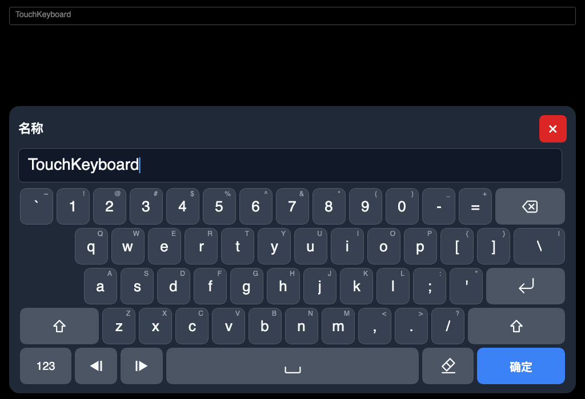

*同一个 AnsiStyle 键盘面在深色预设下的样子。*

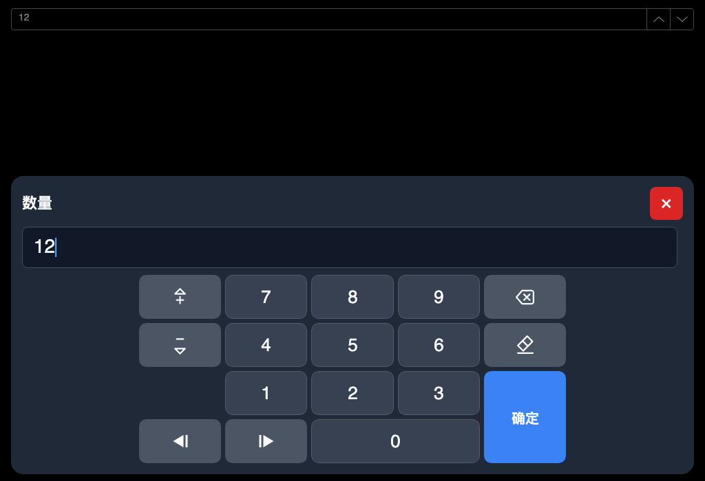

*深色 Numpad；空槽位依然合并进 `0` 和 Confirm。*

按键和头部外框没有悬停状态（它们不是按钮），所以鼠标悬停在触摸面板上不会产生
任何变化。按下时会绘制一层主题化的覆盖色，并把键帽略微缩小，这在两套主题下都
清晰可见。

## 按键图标

`KeyGlyph` 命名了前端自行绘制的语义图标：退格（X 在标签内左移）、清除
（橡皮擦）、回车、Shift（描边和实心两种）、光标箭头（实心三角形加一条光标
竖线）、步进箭头（三角形搭配 `+`/`−` 号）、正负号切换（±）、空格、密码
显示/隐藏、键盘、符号、数字，以及一个预留给未来图标样式的 IME 图标（切换键
使用本地化的 中/英 或 CN/EN 文本；`KeyGlyph.Ime` 保留但未使用）。紧凑键使用
更小的图标系数。图标键仍保留本地化标签；该标签是无障碍名称，也是前端无法
绘制图标时的文本回退。

所有图标都绘制在同一块 24×24 的设计画布上。各图标中的特征元素保持一致的
相对位置：空格键的底边与橡皮擦的基线共用一条线（y = 21.5），因此空格键和
清除键能对齐；密码的眼睛图标与带斜杠的眼睛图标使用同一画布，因此切换可见性
时只有斜杠发生变化。
